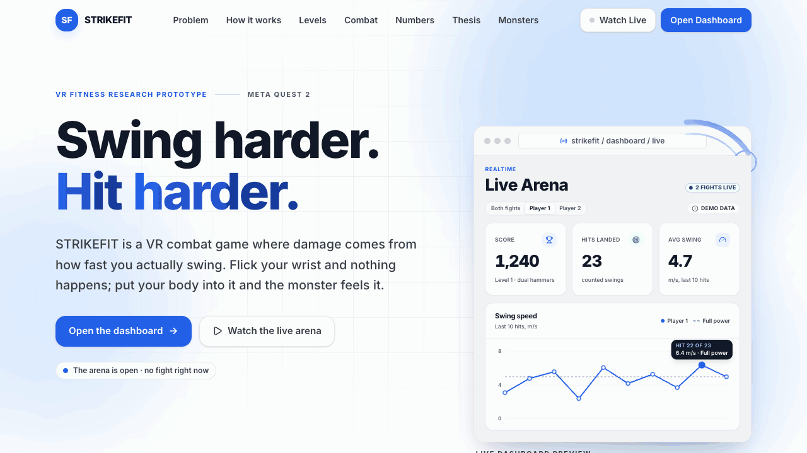
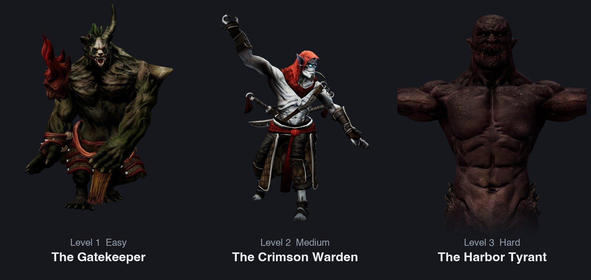
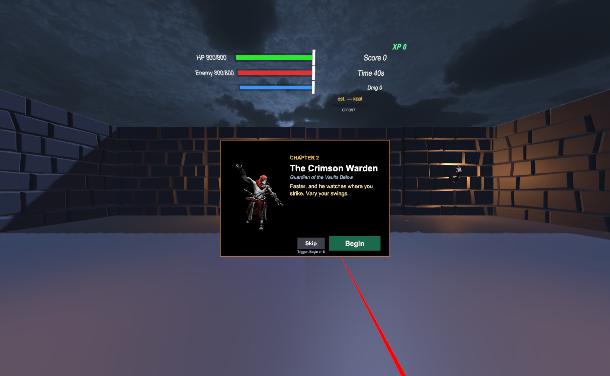
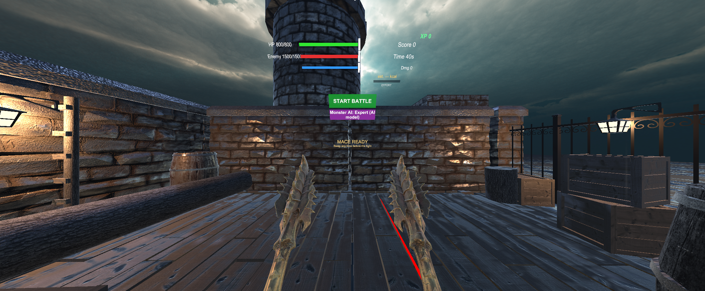
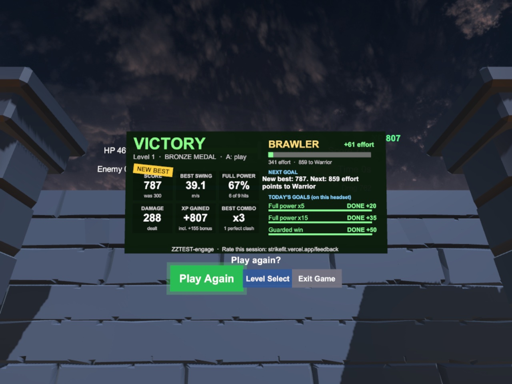
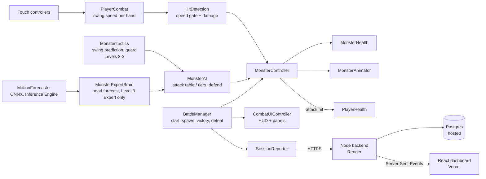
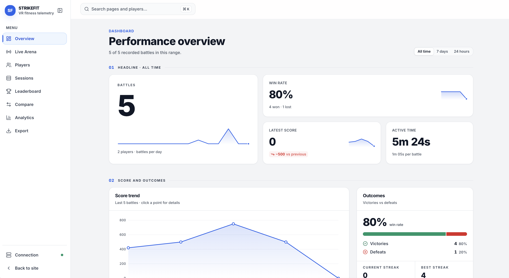
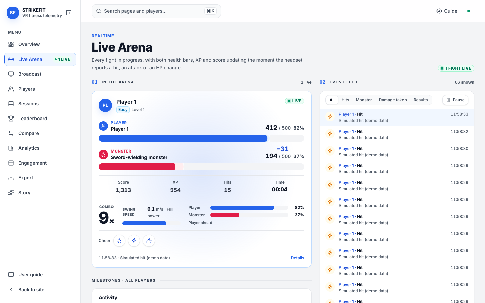
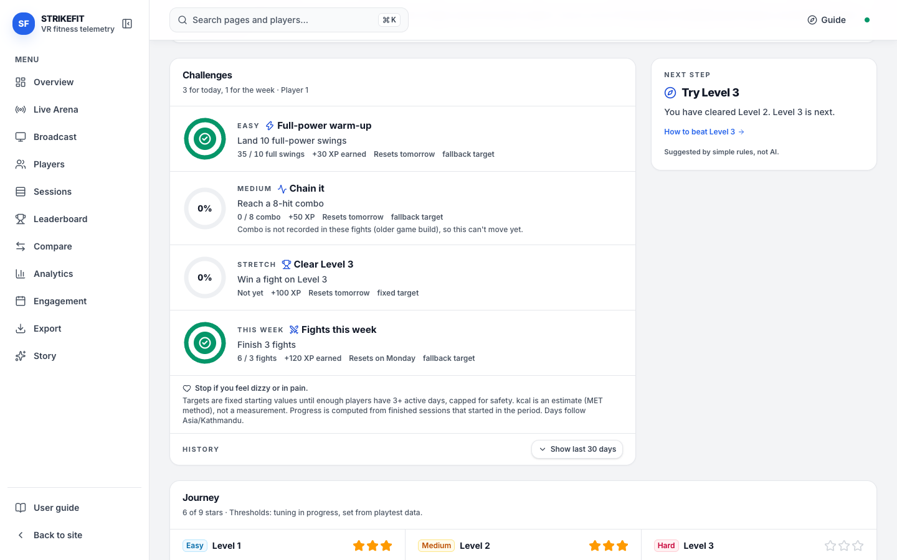
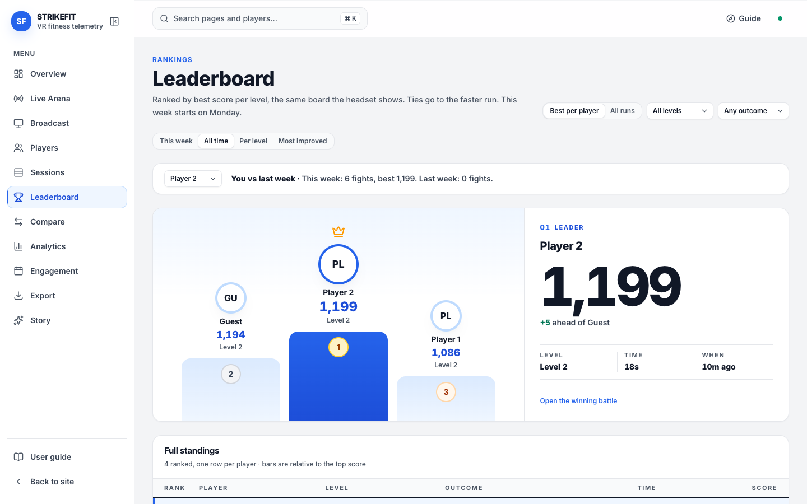

<div align="center">

# S.T.R.I.K.E.F.I.T

### Design, Development, and Evaluation of a Virtual Reality-Based Gamified Fitness System

*Applying Immersive Virtual Reality and Gamification Techniques to Deliver Interactive, Movement-Based Gameplay Experiences to Promote Physical Activity and Long-Term Fitness Engagement Among Young Adults Aged 18-24*

A fitness game that only rewards you when you actually move like you mean it.

[Live site](https://strikefit.vercel.app) · [Dashboard](https://strikefit.vercel.app/dashboard) · [Story](https://strikefit.vercel.app/story) · [Web docs](web/README.md) · [Credits](docs/CREDITS.md)

</div>

<p align="center">
  
  <br>
  <sub>The landing page, top to bottom. <a href="docs/images/hero-poster.png">Still frame</a>.</sub>
</p>

---

## Contents

- [The name](#the-name)
- [The problem it solves](#the-problem-it-solves)
- [What the project does about it](#what-the-project-does-about-it)
- [What makes it different](#what-makes-it-different)
- [How a round plays](#how-a-round-plays)
- [Controls](#controls)
- [Monsters](#monsters)
- [Levels](#levels)
- [Story Mode](#story-mode)
- [The monster's defence AI](#the-monsters-defence-ai)
- [Expert mode (Level 3, optional)](#expert-mode-level-3-optional)
- [Reasons to play again](#reasons-to-play-again)
- [Combat system, real values](#combat-system-real-values)
- [Design principles](#design-principles)
- [Design and development process](#design-and-development-process)
- [Evaluation](#evaluation)
- [Technical architecture](#technical-architecture)
- [Tools and technologies](#tools-and-technologies)
- [Technologies used](#technologies-used)
- [Web dashboard](#web-dashboard)
- [Telemetry pipeline](#telemetry-pipeline)
- [Machine learning: the motion forecaster](#machine-learning-the-motion-forecaster)
- [Run it locally](#run-it-locally)
- [Project structure](#project-structure)
- [Limitations](#limitations)
- [Who it is for](#who-it-is-for)
- [Future prospects](#future-prospects)
- [Acknowledgements](#acknowledgements)

---

## The name

STRIKEFIT is not an abbreviation. It is a compound of two words: **strike** and **fit**. *Strike* is the mechanic the game is built around: a swing only registers when it has real controller velocity behind it, and the damage it deals scales with how hard it was thrown. *Fit* is the outcome: the only way to play well is to keep moving with real physical effort. The dots in S.T.R.I.K.E.F.I.T. are a stylisation, a nod to the way research and robotics systems are often named, and nothing more. The name is deliberately blunt: you strike, you get fit.

---

## The problem it solves

Most people aged 18 to 24 know exercise is good for them and still don't do it consistently. The reasons are familiar: gyms feel repetitive, home workouts get boring after a week or two, and fitness apps that just count reps or minutes give almost nothing back in the moment. The activity itself has to carry all the motivation, and for most people it doesn't, at least not for long.

Virtual reality fitness games try to fix this by wrapping exercise in something that feels like play instead of a chore. But a lot of them solve the wrong problem. They detect whether a gesture happened at all, not whether it was done with any real effort, so a player quickly learns the smallest motion that still counts, and the workout quietly disappears from the fitness game. The result looks interactive but doesn't actually demand much from the body, which defeats the point of building a fitness system in the first place.

STRIKEFIT starts from a different question: **what if the game simply couldn't be played well without real physical effort, because effort itself is the mechanic the game is scoring you on?**

---

## What the project does about it

**1. Damage is tied directly to how hard you swing, not whether you swung at all.**
The player holds a weapon in each hand: hammers in Level 1, swords in Level 2, a mace, war flail or katana in Level 3, and the game tracks real controller velocity through the motion of each swing. A weak flick below a minimum speed threshold is ignored completely; it doesn't register as an attack. Above that threshold, swing speed scales the damage dealt, so a full committed swing does meaningfully more than a lazy one. There's no way to succeed at the game by moving less.

**2. The opponent fights back, so standing still isn't a viable strategy.**
The monster is not a passive target. It attacks on its own timer, with a clear wind-up before the hit lands, giving the player a real window to notice and react rather than an unavoidable scripted hit. If the player isn't in range when the attack resolves, it simply misses. In Level 2 every attack also has a swing arc, so physically stepping back or sidestepping out of the arc is a real dodge.

**3. The fight has rhythm instead of being one repeated animation.**
The monster chooses between different attacks based on its own remaining health. Heavier, slower and more dangerous attacks become more common as it gets hurt, and a desperation attack is reserved for when it's close to defeat. In Level 1 it periodically raises its guard into a short defend state, during which incoming damage is reduced rather than fully applied. In Levels 2 and 3 the guard is driven by a [defence AI](#the-monsters-defence-ai) that predicts where the player's swing will land and blocks that side, within fixed fairness limits, so a fight isn't just a flat race to zero.

**4. Every hit gives immediate feedback.**
Landing a hit on the monster's body, clashing weapon against weapon, taking a hit, and finishing the monster off all have their own distinct sound, layered against background music that's kept deliberately quiet so the combat effects stay clear. Swings themselves whoosh whether they land or not. A hit on the player triggers a brief screen flash and camera shake, so feedback lands through more than one sense at once.

**5. The interface is built to sit in the room with the player, not float over their eyes.**
Health, score, timer, and experience points are shown on a panel fixed in place a short distance in front of the player, rather than a flat overlay stuck to the camera that would either ignore head movement or swim uncomfortably as the player looks around.

**6. Progress is scored on quality, not just contact.**
Every landed hit earns experience points on a scale tied to how full the swing actually was, so scoring reinforces the same thing the damage system does: real effort, not just touching the target.

**7. Every session is recorded.**
Each battle is streamed to a small web backend while it is played (see the [telemetry pipeline](#telemetry-pipeline)). The dashboard shows live hits and past sessions: outcome, damage dealt, hit count, swing speed, duration and HP remaining. This gives the evaluation half of the thesis real data instead of relying on memory or self-report alone.

---

## What makes it different

A lot of VR fitness titles fall into one of two patterns. Either they're closer to a rhythm game, matching a gesture to a timed cue with no real opponent behind it, or they're an arcade combat game where VR controllers were bolted on afterward with simple binary hit detection. STRIKEFIT tries to sit closer to real combat but takes the fitness half of the equation seriously as a design constraint rather than a label. The core damage mechanic is itself a measurement of physical effort, not a separate system layered over ordinary hit detection.

---

## How a round plays

1. **Arrive.** The player stands in the arena. Weapons are hidden, a laser pointer is shown, and no monster is present yet.
2. **Pick a name.** A "Who's playing?" panel offers Player 1, Player 2, Player 3 and Guest. The player points the laser at their name and pulls the trigger; if nobody picks within 10 seconds, the last name used is chosen. The name is locked for the whole fight, so every hit is recorded under the right person.
3. **Start.** The Start button appears only after a name is chosen. The player points the laser at **Start** and clicks it, or presses **B** on the right controller.
4. **Spawn.** The monster spawns a few metres in front of the player and the weapons appear in both hands. The laser is hidden so it can never be confused with a weapon.
5. **Fight.** The monster walks in, telegraphs attacks, swings and defends. The player swings to deal damage and moves to avoid incoming hits.
6. **Finish.** The fight only ends when someone dies. The monster's death plays a collapse animation and sound before the **Victory** panel appears. The player's death plays a death scream before the **Defeat** panel appears.
7. **Replay.** Press **A** to reload the level from a clean state. The name picker comes back with the same name already selected.

---

## Controls

| Input | Action |
|---|---|
| Swing either controller | Attack with the weapon in that hand (speed decides whether it counts and how much damage it does) |
| Laser + trigger on a name | Choose who is playing (before the fight) |
| Laser + trigger on **Start** | Start the battle |
| **B** (right controller) | Start the battle once a name is chosen (same as clicking Start) |
| **A** (after Victory/Defeat) | Replay the level |
| Step back / sidestep | Dodge out of the monster's range or swing arc |
| **R** (editor only) | Replay the level while testing in the Unity Editor |

There is no joystick locomotion. The player moves by physically stepping, which keeps the game comfortable and keeps the effort real.

---

## Monsters

<p align="center">
  
  <br>
  <sub>Rendered from the Unity models. Level 3 is a bust crop of the model.</sub>
</p>

| Level | Name | Weapon | Notable behaviour |
|---|---|---|---|
| 1 | The Gatekeeper | Sword | Slow, clearly telegraphed attacks. Raises its guard from time to time. The easiest fight on purpose. |
| 2 | The Crimson Warden | Two-handed axe | Faster, with a twin-strike combo and a leaping cleave. Forced into its special attack once when it drops below 40% health. Its guard leans toward blocking an angle you repeat. |
| 3 | The Harbor Tyrant (Twin-Axe Brute in the game files) | Two axes, one per hand | 14 attacks: 11 melee, including an unblockable ground slam that has to be dodged, and 3 thrown from range. Three phases, breaking at 66% and 33% health; the last is enraged. Its guard adapts to a repeated angle, and after three blocks in a row the next swing lands. |

Names come from [`content/story.json`](content/story.json), weapons and habits from [`web/frontend/src/lib/monsters.js`](web/frontend/src/lib/monsters.js). Behaviour is as built today; tuning is in progress.

---

## Levels

| Level | Difficulty | Environment | Player weapons | Monster weapon | Full power from |
|---|---|---|---|---|---|
| 1 | Easy | Elementary Dungeon Pack Lite (low poly) | Dual hammers | Sword | 5.0 m/s |
| 2 | Medium | Elementary Dungeon Pack Lite, night sky | Dual swords | Two-handed axe | 4.6 m/s |
| 3 | Hard | Old Sea Port dock arena, lighting escalates with the fight | Mace, war flail or katana, picked up in the arena | Two axes, one per hand | Depends on the weapon |

All levels share the same combat systems. What changes from level to level is the environment, the weapons, the monster, and its tuning.

### Level 1: Easy

A slow, readable introduction. The monster works from a six-attack table plus a periodic defend, with long wind-ups. The fight is designed to teach the core idea: swing hard to deal damage, and watch for the telegraph.

### Level 2: Medium

A faster, more varied fight against a vampire carrying a two-handed axe, driven by a data-driven attack table of ten attacks plus a defend. Selection rules keep it fair but escalating. The same attack is never picked twice in a row, a heavy attack is guaranteed after four light ones, heavy attacks become roughly twice as common as the monster approaches death, and the gap between attacks shortens as it gets hurt. The monster's left hand stays locked on the axe haft through inverse kinematics, letting go only during wide swings where the grip is physically out of reach. Every attack has a swing arc, so stepping out of the arc is a real dodge.

Level 2 also adds fire effects on the axe for its big attacks, a ground burst on impact, a steel-blue tint while the monster defends, a night sky with moonlight and torches, and its own music and sound effects.

### Level 3: Hard

The final fight, in the Old Sea Port dock arena. The player picks up a mace, war flail or katana in the arena. The monster fights with two axes, one per hand, and has 14 attacks: 11 melee, including an unblockable ground slam that has to be dodged, and 3 thrown from range. It moves through three phases, breaking at 66% and 33% health, and the last phase is enraged with faster attacks and shorter telegraphs. The lighting escalates with the fight.

---

## Story Mode

<p align="center">
  
  <br>
  <sub>The chapter card before the Level 2 fight (Editor capture).</sub>
</p>

Story Mode plays the three levels as one run of three chapters. Before each fight a chapter card introduces the guardian; after a victory the chapter is saved and "Continue story" plays the line between fights and loads the next chapter; after the third chapter the ending and a "Story complete" card follow. A defeat offers Retry or the story menu and saves nothing. Free play is unchanged. The story text lives in one file, [`content/story.json`](content/story.json), shared by the game and the website's [story page](https://strikefit.vercel.app/story). Sessions played in Story Mode are tagged `story` in the telemetry.

---

## The monster's defence AI

Levels 2 and 3 share one decision order for the monster ([`MonsterTactics`](Assets/Scripts/Monster/MonsterTactics.cs), [`DefensePolicy`](Assets/Scripts/Monster/Defense/DefensePolicy.cs)):

1. Never interrupt an attack the monster has started. Its recovery is the player's window to punish.
2. Defend a predicted swing. A hand-written **swing predictor** (no machine learning) fits a short curve to the last controller samples of each weapon and projects it 0.15 to 0.35 s ahead to find where and when it would hit the monster's body (left, right, high, low or thrust). If the prediction is confident and there is time to react, the monster guards that side.
3. Riposte right after a block or parry.
4. Punish a missed swing or a retreat.
5. Otherwise pick from the weighted attack table.

The defence is limited on purpose so it stays beatable: a random reaction delay, a speed floor that fast swings beat, one predicted block per cooldown, a hard cap on the block rate per phase (never above 55 %), and a guard meter that every block drains and that breaks into a stagger when empty. Every value is in a per-level `DefenseProfile` asset in `Assets/Settings/Defense/`. Level 1 has no profile and keeps its simple periodic guard.

---

## Expert mode (Level 3, optional)

<p align="center">
  
  <br>
  <sub>The Monster AI toggle under the Start button in Level 3 (Editor capture).</sub>
</p>

Level 3 has a **Monster AI** toggle: **Normal** (the default) or **Expert (AI model)**. It can be changed on the menu's Level 3 card or before a Level 3 fight, is locked during a fight, and is greyed out as "Level 3 only" everywhere else. Levels 1 and 2 never load the model: the rule is checked in code and by tests.

In Expert mode the monster uses a small learned **motion predictor** (see [Machine learning](#machine-learning-the-motion-forecaster)). Twenty times a second the game records the player's head and both controllers; ten times a second the model predicts where they will be 0.25 to 1.0 s later. The monster uses **only the predicted head position, and only up to 0.75 s ahead**, because that is where the prediction measurably beat "the player stays where they are" in the game (see [Limitations](#limitations)):

- **Attack choice:** if the player is predicted to dodge sideways, a narrow attack can be swapped for a sweep that covers where they are going.
- **Timing:** if the player is predicted to close in, a due strike is held back for at most 0.25 s.
- **Aim:** at the start of a wind-up the monster turns toward the predicted position by at most 25°; a gap-closing rush runs along that line and thrown axes are led by at most 0.6 m.

The hand predictions are off by default (`useHandPrediction = false` in the Expert config), so the guard works exactly as in Normal mode. Telegraphs, damage, health, projectile speed and recovery are never changed. A **fairness governor** stops every prediction-based choice while the window is not full, the player is nearly still, the prediction is stale, or the player has already taken more than Normal's hit rate + 20 % in the last minute, and an attack aimed with the prediction never chains into a follow-up. If anything goes wrong (the model is missing, an output is NaN or infinite, inference throws or averages over 3 ms), Expert switches itself off for the rest of the fight, the HUD shows "AI offline - normal behaviour", and the fight continues as Normal.

Development builds include an on-device diagnostics panel (hold **both thumbsticks** pressed in for 2 s) and a log file; see [Run it locally](#run-it-locally).

---

## Reasons to play again

<p align="center">
  
  <br>
  <sub>The result screen after a fight that beat the player's best and reached a new rank (Editor capture).</sub>
</p>

The headset gives players something to come back for, and every piece is logged so the thesis can measure it ([`Assets/Scripts/Engagement/`](Assets/Scripts/Engagement)):

- **Result screen.** Score, best swing, full-power share, damage, XP and best combo, compared with the player's best on that level. Beating it shows **NEW BEST**. There is always one clear next goal ("Beat your best on Level 2: score 121 more points"), and Play Again is the biggest button.
- **Rank.** Rookie, Brawler (300), Warrior (1,200) and Guardian (3,500) effort points: counted swings + 2 per full-power swing + 40 per win (+60 more for a Level 3 win), the same formula as the website. The rank shows beside the name in the menu and on the HUD, with a **RANK UP** banner once per new rank.
- **Today's goals.** Three goals a day: the website's daily challenges when the backend answers, otherwise three seeded local goals. A completed goal shows once and gives a small XP bonus.
- **Perfect clash.** Meeting the monster's strike in the last 0.15 s before it lands gives bonus XP, a distinct flash, haptics and a short stagger once the attack is over. It never changes the monster's damage.
- **Weapon glow palettes.** Cosmetic resting colours for the weapons, unlocked by rank and chosen per player in the menu.
- **Measurement.** Each fight ends with an `engagement_summary` event (rank before and after, new best, goals completed, perfect clashes, fights today). See [`docs/engagement-inventory.md`](docs/engagement-inventory.md).

---

## Combat system, real values

These values were read from the live scenes and verified in Play mode when this section was written (README of 29 September 2026). They are development values: tuning has continued since, so treat the table as a snapshot and see [`project_progress.md`](Assets/Documentation/project_progress.md) for later changes. Player and monster health are left out because the web config and the running scene disagree for Level 2.

| | Level 1 (Easy) | Level 2 (Medium) |
|---|---|---|
| Player weapons | 2 hammers | 2 swords (two different models) |
| Minimum swing speed to count | 1.2 m/s | 1.2 m/s |
| Hit cooldown per weapon | 0.35 s | 0.28 s |
| Example player damage | ~23 at 4 m/s, ~33 at 7 m/s | ~19 at 5 m/s |
| Monster base damage | 8.8 (heavy 10.6, special 13.2) | 16.8, scaled 0.75× to 2.0× per attack (12.6 to 33.6) |
| Wind-up before a hit | 0.9 s standard, up to 1.5 s special | ~0.6 s standard, up to 1.5 s slam |
| Time between attacks | 3.2 s | 2.2 s, shrinking to ~1.9 s at low HP |
| Defend | 1.5 s every 8 s, 70% reduction | 1.0 s every 5.5 s, 70% reduction |
| Weapon clash | Hitting the monster's sword = 0 damage + clash sound | Hitting the axe head or haft = 0 damage + clash sound |
| Dodging | Get out of range | Get out of range **or** out of the swing arc |

How player damage is calculated: base damage is multiplied by a factor that rises from 1× to 2.5× between 1.2 m/s and 8 m/s of swing speed, then adjusted by swing angle, facing and weapon type. A swing slower than 1.2 m/s does nothing at all.

---

## Design principles

- **Effort is the input.** Nothing in the combat loop rewards small or lazy movement. Speed decides both whether a hit counts and how much it does.
- **Every hit is readable.** The monster always telegraphs with a sound and a body flash before damage lands, so getting hit feels like a mistake the player could have avoided, not bad luck.
- **Fair, not easy.** Dodging uses the player's real position. Range is measured horizontally to the headset, so a real step back really gets you out of the way.
- **Escalation over repetition.** Fights get harder as they go on (faster, heavier attacks), which keeps the end of a fight as engaging as the start.
- **Feedback through more than one sense.** Sound, colour flashes, screen flash and camera shake all confirm what just happened.
- **Comfort first.** No artificial locomotion, no HUD glued to the face, and the UI sits in the room at a readable distance.
- **One set of systems, many levels.** Levels are configuration and content, not new code, so every fix to the core loop benefits every level.

---

## Design and development process

The project follows an iterative build, verify, headset-test loop:

1. **Design.** Define the level's fantasy, weapons and difficulty target (attack pacing, reaction windows, HP).
2. **Build.** Implement in Unity using the shared combat scripts, adding only what the level genuinely needs. For example, the attack table and two-handed IK were built for Level 2 but in a way that leaves Level 1's behaviour untouched.
3. **Verify in the editor.** Development used Cursor connected to a Unity MCP server, so scenes, components and values could be inspected directly in the live Unity Editor rather than assumed from code. Each change was then exercised in Play mode, for example by firing the real UI raycast at the Start button, calling the real hit detection at known swing speeds, sampling the Animator at each damage frame, and running 1,000-pick simulations of the attack selection.
4. **Test on the headset.** Anything that depends on real hands, real swing speeds or real movement is confirmed on Quest 2.
5. **Record honestly.** Findings, including earlier claims that turned out to be wrong, are logged in [`project_progress.md`](Assets/Documentation/project_progress.md) with what was actually true and how it was fixed.

This process caught problems that code review alone would have missed. Examples include a Start button with no click listener, a UI canvas facing away from the player, a 40-second timer that declared Victory with the monster still at full health, animator transitions that could cancel attacks mid-swing, and a monster weapon collider that only existed on an unused scene copy, so weapon clashes could never happen.

---

## Evaluation

The central question of the thesis is whether tying damage to swing velocity makes players move more and stay engaged longer than a standard exergame that only checks whether a hit happened.

What the game already measures for every session:

| Measure | What it tells us |
|---|---|
| Hit count and damage dealt | How much and how hard the player swung |
| Damage per hit (sent live with each hit) | Intensity of effort over the session, since damage scales with swing speed |
| Session duration | How long the player stayed engaged |
| Outcome and HP remaining | Whether the difficulty felt achievable |
| Repeat sessions per player | Whether players come back (long-term engagement) |

This data flows from the headset to the [web stats dashboard](#web-dashboard) and is stored per session, so it can be exported and analysed alongside participant feedback once playtesting begins.

---

## Technical architecture

The game is built in Unity 6 with the Universal Render Pipeline, targeting Meta Quest 2 through the Meta XR SDK and OpenXR. Player input comes entirely from tracked Touch controllers, and combat detection is based on collider overlap combined with real-time controller velocity rather than any external sensor.

Monster animation uses Humanoid-retargeted Mixamo clips (idle, several attack variants, defend, hit reaction and death), driven by Unity Animator Controllers. In Level 2, every attack starts from Idle on its own trigger and only Death can interrupt from any state, so a player's hit can never cancel a monster's swing halfway through.



| Script | Responsibility |
|---|---|
| `Combat/BattleManager` | Battle lifecycle: start (laser or B button), monster spawn, victory and defeat, replay |
| `Combat/HitDetection` | Speed gate, damage calculation, weapon-clash detection |
| `Combat/WeaponSwingAudio` | Whoosh sound on every fast swing, per hand |
| `Player/PlayerCombat` | Weapon loadout per hand, swing speed tracking |
| `Player/PlayerHealth` | Player HP, hurt and death feedback |
| `Player/EditorHandPoseFallback` | Editor-only: puts untracked hands in a resting pose so weapons don't fill the camera when no headset is connected |
| `Monster/MonsterAI` | Movement, attack selection (legacy tiers or attack table), telegraphs, defend, weapon VFX |
| `Monster/MonsterController` | Attack and damage state, defend damage reduction, death |
| `Monster/MonsterAnimator` | Animator trigger handling (resets every trigger to prevent stale transitions) |
| `Monster/MonsterHealth` | Monster HP |
| `Monster/TwoHandedWeaponIK` | Keeps the monster's left hand on a two-handed weapon |
| `Monster/MonsterTactics`, `Monster/Defense/*` | Levels 2-3 decision order: swing prediction, predicted blocks, ripostes, punishes, fairness limits |
| `Monster/MonsterExpertBrain` | Level 3 Expert only: turns the head forecast into attack choice, timing and aim, through the fairness governor |
| `Monster/ExpertMotionPredictor`, `Monster/ExpertAI/*` | 20 Hz sampling, feature building, the ONNX model run over several frames, fallback rules |
| `Monster/ExpertDiagnostics` | Development builds only: the diagnostics panel and `expert_diagnostics.txt` |
| `Combat/StoryDirector` | Story Mode: chapter cards, saving progress, loading the next chapter |
| `Manager/LevelManager` | Per-level difficulty values and weapon loadouts |
| `Manager/GameStateManager`, `RoundManager`, `XPManager` | Game state, round timer, experience points |
| `UI/CombatUIController` | HUD bars, texts and Victory/Defeat panels |
| `UI/PlayerNamePicker` | Pre-battle name choice (laser-clickable presets); Start stays hidden until a name is picked |
| `Networking/SessionReporter` | Streams the session, live combat events and the final result to the web backend; failures are dropped silently so the game never waits on the network |

---

<div align="center">

## Tools and technologies

**Game**

<p align="center">
  
  
  
  
  
  
  
  
</p>

**Web and backend**

<p align="center">
  
  
  
  
  
  
  
</p>

**Hosting and tooling**

<p align="center">
  
  
  
  
  
</p>

</div>

---

## Technologies used

### VR game

| Area | Technology | What it does in STRIKEFIT |
|---|---|---|
| Engine | **Unity 6** (6000.5.11f1) | Game engine for every level scene |
| Rendering | **Universal Render Pipeline 17.5** | Mobile-friendly lighting and materials that hold frame rate on Quest |
| XR runtime | **Meta XR SDK 205** + **OpenXR 1.17** | Headset and Touch controller tracking, camera rig, UI laser input |
| Input | **Unity Input System 1.20** | Controller buttons (A, B, trigger) and editor shortcuts |
| Language | **C#** | All gameplay code: combat, AI, networking, UI |
| Target device | **Meta Quest 2** (Android) | Standalone headset the game is built and tested on |
| Characters and animation | **Mixamo** clips on Humanoid rigs, **Animator Controllers**, humanoid **IK** | Monster movement and attacks, two-handed axe grip in Level 2 |
| Inference | **Unity Inference Engine 2.6** (`com.unity.ai.inference`), CPU backend | Runs the motion forecaster (ONNX) in Level 3 Expert mode |
| Effects | **Particle Systems**, baked **reflection probes** | Axe fire, ground impact bursts, readable metal on weapons |
| Environments | **Elementary Dungeon Pack Lite** (Gridness Studios), **Old Sea Port** | Level 1 and 2 arena, Level 3 setting (Unity Asset Store) |
| Audio | Layered SFX and music (some Level 2 effects synthesised for the project) | Distinct sounds for swings, hits, clashes, telegraphs, defends, damage and death |

### Web platform

| Area | Technology | What it does in STRIKEFIT |
|---|---|---|
| API | **Node.js** + **Express 4** | Receives sessions and combat events from the headset, serves stats |
| Database | **PostgreSQL** (hosted on Layerbase, earlier on Neon) | Stores every session and event for analysis |
| Realtime | **Server-Sent Events** | Pushes hits and HP changes to open dashboards as they happen |
| Dashboard | **React 18**, **React Router 6**, **Vite 6** | Live arena, players, sessions, leaderboard, compare, analytics, export |
| Styling | **Tailwind CSS 4**, **Lucide** icons | Consistent, responsive UI on desktop and phone |
| Hosting | **Render** (API), **Vercel** (dashboard) | Public https endpoints the headset and browsers can reach |

### Machine learning (`ml-services/`)

| Area | Technology | What it does in STRIKEFIT |
|---|---|---|
| Language and packaging | **Python 3.12+**, **uv** | Reproducible environment from `uv.lock` |
| Model | **PyTorch** | GRU and MLP forecasters, training with early stopping |
| Data and evaluation | **NumPy**, **pandas**, **SciPy**, **scikit-learn**, **Matplotlib** | Cleaning, features, cross-validation, bootstrap intervals, figures |
| Export | **ONNX** (opset 15), **ONNX Runtime** | The model file Unity loads, checked against PyTorch |
| Notebooks and tests | **JupyterLab**, **pytest** | One notebook per pipeline step; tests that need no dataset |

### Development workflow

| Area | Technology | What it does in STRIKEFIT |
|---|---|---|
| Editor | **Cursor** | Code editing and AI-assisted development |
| Tests | **Unity Test Framework** (EditMode), Node's test runner, pytest | Game logic, model parity and fairness rules; web logic; the ML pipeline |
| Editor integration | **Unity MCP** (MCP for Unity) | Inspecting and testing the live Unity Editor: scenes, components, Play mode |
| Version control | **Git** + **GitHub** | History, with a Unity-specific `.gitignore` and `.gitattributes` to keep generated files and large binaries out |

---

## Web dashboard

<p align="center">
  <a href="docs/images/dashboard-overview.png"></a>
  <a href="docs/images/dashboard-live.png"></a>
</p>
<p align="center">
  <a href="docs/images/dashboard-player.png"></a>
  <a href="docs/images/dashboard-scoreboard.png"></a>
</p>
<p align="center"><sub>Overview, Live Arena, a player page and the leaderboard (click for full size). Shot from a local backend with simulated fights for players named Player 1, Player 2, Player 3 and Guest. The Live Arena fight is simulated data.</sub></p>

What the dashboard does:

- **Live arena.** Every fight in progress, with both health bars, XP and score moving as the headset reports hits. Viewers can send cheers.
- **Estimated calories.** Calculated from fight length and swing strength with an assumed body mass. It is an estimate, not a measurement.
- **Challenges.** Daily and weekly targets per player, mastery stars per level and a suggested next step.
- **Scoreboard.** Best score per player, by week, all time or level.
- **Survey.** A short rating form for players after a session.
- **Practice (`/practice`).** Try the swing-to-damage rule without a headset, with phone motion, a mouse or touch. Nothing is sent.
- Also: session history, player pages, compare, analytics, calendar and weekly recap, CSV export and the story page.

The backend is Node and Express on Render, storing every session and event in Postgres (hosted on Layerbase, earlier on Neon). The dashboard is React on Vercel and listens to the backend over Server-Sent Events.

---

## Telemetry pipeline

```
Quest headset ── SessionReporter ──HTTPS──▶ Node/Express API ──▶ Postgres
                                                 │
                                                 └─ Server-Sent Events ──▶ dashboard, Live Arena, /watch
```

- **At battle start** the headset opens a live session (player, level, mode `free` or `story`, Monster AI mode).
- **During the fight** combat events go into a bounded buffer and are sent in batches, with an HP snapshot every second: hits (swing speed, power tier, hand, damage, combo), the player being hurt, weapon clashes, the guard events of Levels 2-3 (`predicted_block`, `parry`, `counter`, `guard_break`) and an effort and calorie estimate.
- **At the end** the final stats go out, plus one `monster_ai_summary` per fight: Normal or Expert, whether the model loaded, the number of inferences, average and maximum inference time, fallbacks and their reason, how many decisions the prediction changed, damaging hits on the player, and (Expert) whether hand prediction was on and the furthest horizon used.
- **Networking never blocks gameplay.** At most one request is in flight; a failed batch is dropped.

The backend stores sessions and events in Postgres and pushes every change to open dashboards over Server-Sent Events. Calories are an estimate from fight length and swing strength with an assumed body mass, not a measurement.

---

## Machine learning: the motion forecaster

The full write-up is in [`ml-services/model.md`](ml-services/model.md); the code and how to run it are in [`ml-services/README.md`](ml-services/README.md).

- **Task.** From the last 1.0 s of head and two-hand positions, predict where each of the three will be 0.25, 0.5, 0.75 and 1.0 s later (36 numbers).
- **Data.** The public **Touché** sword-strike recordings (Dehesa, Vidler, Lutteroth, Padget, CHI 2020, CC BY 4.0): 8 recordings, 12.1 minutes of sword strikes in a lab (probably by very few people), resampled to 20 Hz and converted from centimetres to metres.
- **Features.** 22 per frame over 20 frames: positions relative to the current head, velocities, both hand speeds, head height and grip.
- **Splits.** Only 8 recordings and no participant IDs, so 5-fold cross-validation **by recording**: every recording is test data exactly once, for a model that never saw it. Normalisation uses training data only.
- **Baselines.** "Stays still" (predict no movement) and "constant velocity".
- **Models.** A GRU (19,236 parameters) and an MLP (77,604), Huber loss, AdamW, early stopping.

Mean error in cm on the test recordings (lower is better; 95 % bootstrap interval over recordings):

| model | overall | 0.25 s | 0.50 s | 0.75 s | 1.00 s |
|---|---|---|---|---|---|
| stays still (baseline) | 46.8 [45.5, 48.1] | 30.9 | 48.3 | 54.2 | 53.8 |
| constant velocity (baseline) | 101.6 [97.7, 105.4] | 39.0 | 85.8 | 124.7 | 157.0 |
| MLP | 31.7 [29.9, 33.3] | 19.0 | 31.3 | 36.8 | 39.6 |
| **GRU (used in the game)** | **31.0 [29.2, 32.7]** | **18.4** | **30.8** | **36.1** | **38.7** |

On this dataset the GRU is about a third more accurate than the best baseline. A re-run of the whole pipeline on 23 October 2026 gave the same baseline and GRU numbers (the MLP moved by 0.08 cm overall).

**Export and use in Unity.** The GRU is exported to ONNX (opset 15, fixed shapes) with the GRU written out as plain matrix operations so Unity needs no special operator; PyTorch and ONNX agree to 1e-6. The model, `norm.json` (scaling) and `golden_vector.json` (one real input with its expected output) are copied to `Assets/Models/ExpertAI/` by `ml-services/scripts/sync_model_to_unity.sh`, which checks the SHA-256 of every copy. In the game, Unity's Inference Engine runs the model on the CPU, spread over several frames; an EditMode test checks that Unity's output matches the golden vector within 1e-4.

---

## Run it locally

**Game.** Unity **6000.5.11f1** with Android Build Support, and a Meta Quest 2 in developer mode (Link or Air Link works for editor testing).

1. `git clone https://github.com/dabster108/vr-fitness-monster-battle.git`
2. Open the `VR-Gamification-Fitness` folder in Unity Hub. The first import takes a while.
3. Open a scene under `Assets/Scenes/` (`MainMenu`, `Level1_Easy`, `Level2_Medium` or `Level3_Hard`) and press Play. Without a headset the weapons rest in front of the camera so a scene can still be inspected.
4. To build for Quest, switch the platform to Android, put the scenes in the build list with `MainMenu` first, and choose Build And Run.

**Game tests and compile check from the command line** (Unity closed):

```bash
UNITY=/Applications/Unity/Hub/Editor/6000.5.11f1/Unity.app/Contents/MacOS/Unity   # adjust to your install
$UNITY -batchmode -nographics -quit -projectPath "$PWD" -logFile compile.log
$UNITY -batchmode -nographics -projectPath "$PWD" -runTests -testPlatform EditMode -testResults results.xml -logFile tests.log
```

**Expert mode diagnostics** (Development builds and the Editor only). Hold both thumbsticks pressed in for 2 s to show or hide a panel with: Expert on/off, model loaded, average and maximum inference time over the last 5 s, fallbacks, the outputs in use, the axis mapping, the window fill and the frame time. The same numbers are written once a second during a Level 3 Expert fight to `expert_diagnostics.txt` in the app's persistent data folder. From a Quest:

```bash
adb pull /sdcard/Android/data/com.UnityTechnologies.com.unity.template.urpblank/files/expert_diagnostics.txt
```

(The Android package name is still the Unity template's; change the path if you change the package name.) Pressing both thumbsticks also toggles the combat debug readout, as before.

**Machine learning.** Python 3.12+ and [uv](https://docs.astral.sh/uv/). The raw Touché data is not in the repository (see `ml-services/README.md`).

```bash
cd ml-services
uv sync                                   # install
uv run pytest -q                          # tests that need no dataset
uv run python -m strikefit_ml.pipeline    # the whole pipeline (needs the data; rewrites models/ and reports/)
scripts/sync_model_to_unity.sh --check    # are the Unity copies identical to models/?
```

**Web.** Node.js 18 or newer.

```bash
# terminal 1: API on http://localhost:4000 (needs web/backend/.env)
cd web/backend && npm install && npm start

# terminal 2: site and dashboard on http://localhost:5173, proxying /api to the API
cd web/frontend && npm install && npm run dev

# tests
cd web/backend && npm test
cd web/frontend && npm test

# optional: play a simulated fight so the live views move
cd web/backend && npm run simulate -- --url http://localhost:4000 --level Medium --seconds 30
```

Environment variables, names only. Set them in `web/backend/.env` (git-ignored) or in the host's dashboard, never in the repository.

| Where | Names |
|---|---|
| Backend | `DATABASE_URL` (required), `PORT`, `ALLOWED_ORIGINS`, `REACTIONS_ENABLED`, `BROADCAST_KEY`, `LEADERBOARD_BLOCKLIST` |
| Backend, optional relay for the live broadcast | `CLOUDFLARE_TURN_KEY_ID`, `CLOUDFLARE_TURN_API_TOKEN`, `TURN_URLS`, `TURN_USERNAME`, `TURN_CREDENTIAL` |
| Frontend | `VITE_API_URL` (build), `BACKEND_URL` (dev proxy) |

The headset build points at the hosted backend through **SessionReporter, Base Url** (https is required on Quest). Deployment steps and API routes are in [`web/README.md`](web/README.md) and [`web/backend/README.md`](web/backend/README.md).

| Folder | Contents |
|---|---|
| `Assets/` | Unity scenes, scripts, prefabs, models, animation, audio and VFX |
| `web/backend/` | Express API, Postgres schema, live stream |
| `web/frontend/` | React site and dashboard |
| `web/tools/` | Local-only tools: monster portrait renderer, README media capture |
| `ml-services/` | The motion forecaster: data pipeline, training, evaluation, ONNX export, notebooks, tests |
| `content/` | `story.json`, the story text shared by the game and the site |
| `docs/` | Credits and the images used in this README |

---

## Project structure

```
VR-Gamification-Fitness/
├── Assets/
│   ├── Scenes/           MainMenu, Level1_Easy, Level2_Medium, Level3_Hard, Results
│   ├── Scripts/          Combat, Player, Monster (+ Defense, ExpertAI), Manager, UI, Networking (+ Legacy)
│   ├── Prefabs/          Monsters and weapons
│   ├── Models/           Monster and weapon models; ExpertAI/ holds the ONNX model, norm.json, golden_vector.json
│   ├── Settings/Defense/ Defence profiles per level and the Level 3 Expert config
│   ├── Tests/EditMode/   Defence and Expert AI tests
│   ├── Animations/       Monster Animator Controllers and Mixamo clips
│   ├── Materials/        URP materials per level
│   ├── Audio/            Music and SFX
│   ├── VFX/              Fire and impact effects
│   └── Documentation/    Setup guide, move list, context, detailed progress log
├── web/
│   ├── backend/          Node + Express API, Postgres schema, live stream
│   ├── frontend/         React + Vite dashboard and landing page
│   └── tools/            Local-only tools: monster portrait renderer, README media capture
├── ml-services/
│   ├── src/strikefit_ml/ One module per pipeline step
│   ├── notebooks/        One notebook per step, with plots
│   ├── configs/          Every setting of the pipeline
│   ├── models/           The exported model and its files (data/ is not committed)
│   ├── reports/          Result tables and figures
│   └── scripts/          sync_model_to_unity.sh
├── content/              story.json, the story text shared by the game and the site
├── docs/                 Credits and the images used in this README
├── Packages/
└── ProjectSettings/
```

---

## Limitations

- **Small public dataset, different movement.** The motion forecaster learned from 8 recordings (about 12 minutes) of sword strikes in a lab, probably by very few people. Players in STRIKEFIT dodge and attack a monster, which is different movement.
- **Hand predictions are not used.** On the dataset the model beat "stays still" for every point. In the game, measured on the same moments with scripted player motion ([`Captures/ExpertAI/L3_expert_60s.txt`](Captures/ExpertAI/L3_expert_60s.txt)), the head prediction beat "stays still" up to 0.75 s (for example 8.0 against 14.1 cm at 0.25 s, 32.3 against 35.6 cm at 0.75 s) and not at 1.0 s, while the dominant-hand prediction was worse at every horizon (43.0 against 17.3 cm at 0.25 s). That is why Expert mode reads the head only, up to 0.75 s.
- **Never measured on a Quest yet.** Inference times (1.4 ms average in the Editor harness) and the diagnostics have only run in the Unity Editor. Frame time and inference cost on a Quest 2 are still to be measured.
- **Axis mapping unverified on real tracking.** The mapping between Unity's axes and the dataset's was chosen with synthetic walking motion; it has not been checked against real arm movement.
- **No measurable gameplay difference yet.** In 60-second scripted fights Expert and Normal were about the same (21 against 20 monster attacks, 24 against 26 damaging hits on the player per minute). Whether Expert changes how a fight feels is open.
- **No user study yet.** The playtest study (consent, questionnaires, exertion ratings) is built into the website but has not been run, so there are no results about exertion, engagement or enjoyment yet.
- **Estimates, not measurements.** Calories are estimated from fight length and swing strength with an assumed body mass. There is no heart-rate input.
- **Tuning is ongoing.** The values in [Combat system, real values](#combat-system-real-values) are a snapshot.

---

## Who it is for

This project was built as an undergraduate thesis at **Softwarica College**, under the supervision of **Manoj Shrestha**, examining how gamified, movement-based VR gameplay affects physical activity levels and long-term engagement with fitness among young adults aged 18 to 24. It is aimed at researchers studying motivation in exergames, VR users looking for a more physically demanding alternative to gesture-matching fitness titles, and young adults who find traditional exercise routines difficult to stick with.

---

## Future prospects

- Headset-test and balance Levels 2 and 3 with real players. Tuning is in progress.
- Measure Expert mode on a Quest 2 (inference time, frame time, fallbacks) with the diagnostics log, and check the axis mapping with real movement.
- Record STRIKEFIT's own movement data and retrain the forecaster on it, then re-test whether hand predictions help.
- Run the whole flow (menu, Level 1, Level 2, Level 3, results) on the headset as one build and confirm it end to end.
- Rebalance health, damage and cooldown values using real playtesting data.
- Add heart-rate input. The dashboard already shows calories as an estimate from fight length and swing strength, which is not a measurement.
- Evaluate whether the velocity-linked damage system measurably increases physical exertion and session engagement compared to a standard, binary hit-detection exergame, which is the central question this thesis sets out to answer.
- Study long-term engagement: whether players return across multiple sessions, and what that suggests about the format's potential for sustained fitness habits.

Known limitations and the detailed status of each level are kept in [`project_progress.md`](Assets/Documentation/project_progress.md).

---

## Documentation

| Document | Contents |
|---|---|
| [`Assets/Documentation/project_progress.md`](Assets/Documentation/project_progress.md) | Detailed, verified progress log per level, including corrections, known limitations and the roadmap |
| [`Assets/Documentation/context.md`](Assets/Documentation/context.md) | Project overview, levels, asset locations |
| [`Assets/Documentation/SETUP_GUIDE.md`](Assets/Documentation/SETUP_GUIDE.md) | Level scenes and weapon setup |
| [`web/README.md`](web/README.md) | Web backend and dashboard |
| [`ml-services/README.md`](ml-services/README.md), [`ml-services/model.md`](ml-services/model.md) | The motion forecaster: how to run it, data, model, results and limits |
| [`docs/engagement-inventory.md`](docs/engagement-inventory.md) | The engagement features (web and headset), how the summary event is stored, and what was verified |
| [`docs/performance-audit.md`](docs/performance-audit.md) | Quest 2 performance audit: measurements, the changes made and what only a headset can confirm |
| [`docs/color-audit.md`](docs/color-audit.md) | The colour compositor: layers, priorities and per-level palettes |
| [`docs/demo-clip.md`](docs/demo-clip.md) | How the Level 2 demo clip on the landing page was recorded and encoded |
| [`docs/CREDITS.md`](docs/CREDITS.md) | Credits for models, animation, audio and environments |

---

## Acknowledgements

Softwarica College, for the resources and environment to build this project, and Manoj Shrestha, for supervision throughout its development. The motion forecaster is trained on the **Touché** dataset: J. Dehesa, A. Vidler, C. Lutteroth and J. Padget, "Touché: Data-Driven Interactive Sword Fighting in Virtual Reality", CHI 2020, licensed CC BY 4.0. Thanks also to Gridness Studios for the Elementary Dungeon Pack Lite, the creators of the Old Sea Port environment pack, Adobe Mixamo for characters and animation, and the Unity and Meta XR SDK communities whose documentation made a project of this scope possible for a single developer working toward a thesis deadline.

---

Development notes and progress: [`Assets/Documentation/project_progress.md`](Assets/Documentation/project_progress.md)
