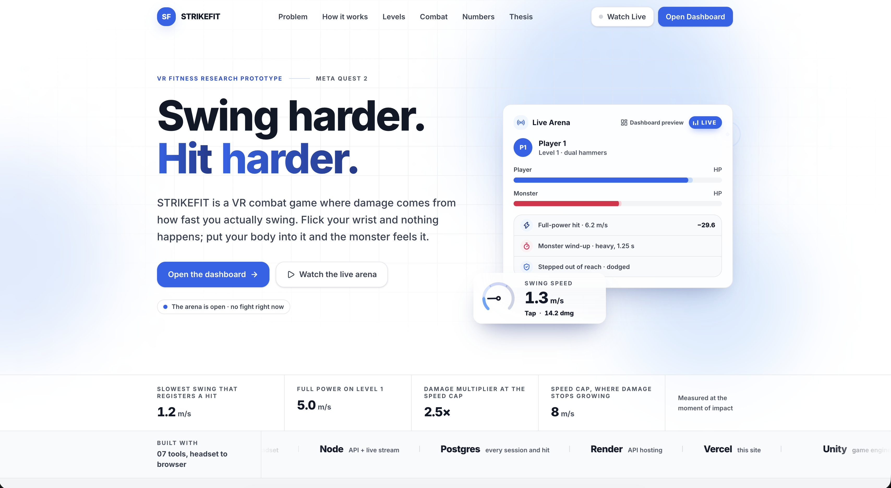
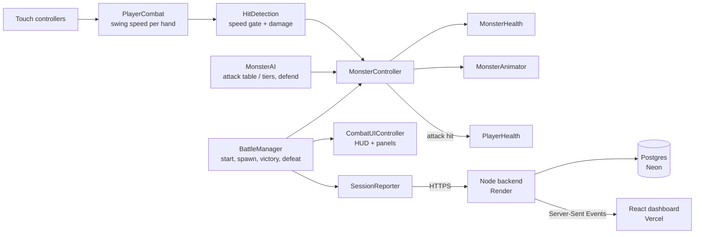
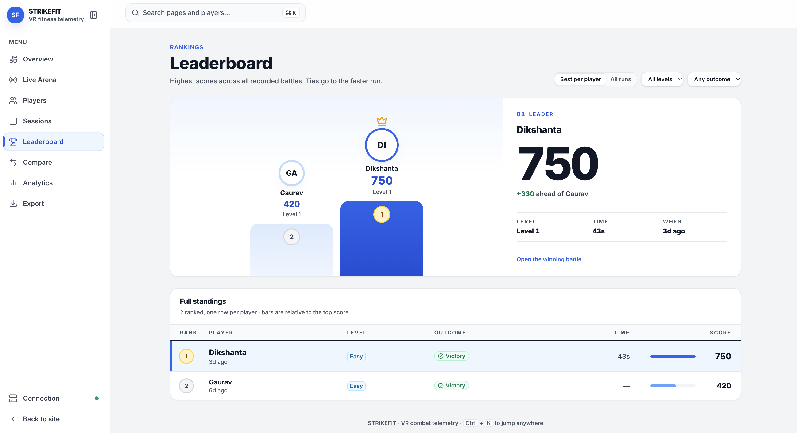
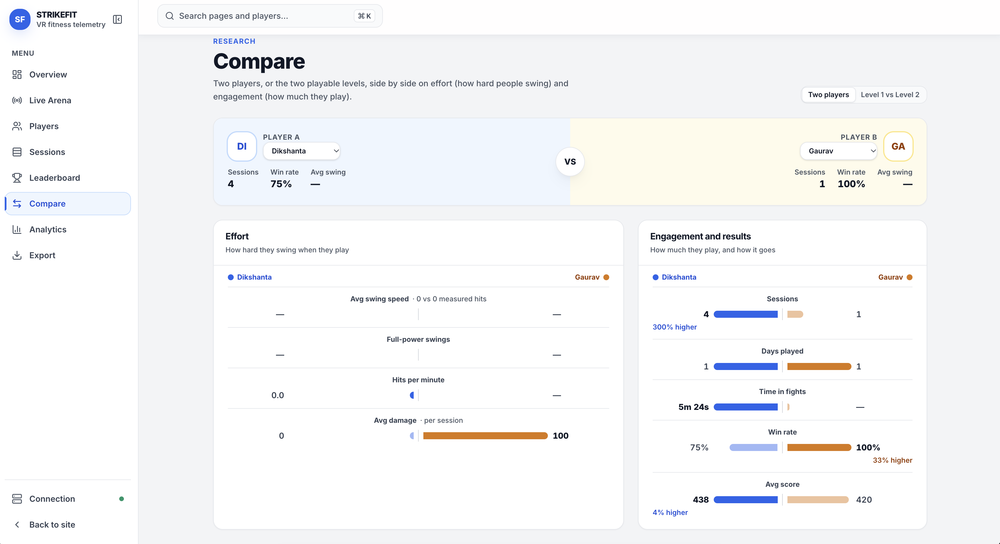

# S.T.R.I.K.E.F.I.T

### Design, Development, and Evaluation of a Virtual Reality-Based Gamified Fitness System

*Applying Immersive Virtual Reality and Gamification Techniques to Deliver Interactive, Movement-Based Gameplay Experiences to Promote Physical Activity and Long-Term Fitness Engagement Among Young Adults Aged 18–24*

A fitness game that only rewards you when you actually move like you mean it.


<p align="center">
  
</p>

---

## Contents

- [The name](#the-name)
- [The problem it solves](#the-problem-it-solves)
- [What the project does about it](#what-the-project-does-about-it)
- [What makes it different](#what-makes-it-different)
- [How a round plays](#how-a-round-plays)
- [Controls](#controls)
- [Levels](#levels)
- [Combat system, real values](#combat-system-real-values)
- [Design principles](#design-principles)
- [Design and development process](#design-and-development-process)
- [Evaluation](#evaluation)
- [Technical architecture](#technical-architecture)
- [Web stats dashboard](#web-stats-dashboard)
- [Screenshots](#screenshots)
- [Project structure](#project-structure)
- [Getting started](#getting-started)
- [Technologies used](#technologies-used)
- [Who it is for](#who-it-is-for)
- [Current status and known limitations](#current-status-and-known-limitations)
- [Future prospects](#future-prospects)
- [Documentation](#documentation)
- [Acknowledgements](#acknowledgements)

---

## The name

STRIKEFIT is not an abbreviation. It is a compound of two words: **strike** and **fit**. *Strike* is the mechanic the game is built around — a swing only registers when it has real controller velocity behind it, and the damage it deals scales with how hard it was thrown. *Fit* is the outcome: the only way to play well is to keep moving with real physical effort. The dots in S.T.R.I.K.E.F.I.T. are a stylisation, a nod to the way research and robotics systems are often named, and nothing more. The name is deliberately blunt: you strike, you get fit.

---

## The problem it solves

Most people aged 18 to 24 know exercise is good for them and still don't do it consistently. The reasons are familiar: gyms feel repetitive, home workouts get boring after a week or two, and fitness apps that just count reps or minutes give almost nothing back in the moment. The activity itself has to carry all the motivation, and for most people it doesn't, at least not for long.

Virtual reality fitness games try to fix this by wrapping exercise in something that feels like play instead of a chore. But a lot of them solve the wrong problem. They detect whether a gesture happened at all, not whether it was done with any real effort, so a player quickly learns the smallest motion that still counts, and the workout quietly disappears from the fitness game. The result looks interactive but doesn't actually demand much from the body, which defeats the point of building a fitness system in the first place.

STRIKEFIT starts from a different question: **what if the game simply couldn't be played well without real physical effort, because effort itself is the mechanic the game is scoring you on?**

---

## What the project does about it

**1. Damage is tied directly to how hard you swing, not whether you swung at all.**
The player holds a weapon in each hand — hammers in Level 1, swords in Level 2 — and the game tracks real controller velocity through the motion of each swing. A weak flick below a minimum speed threshold is ignored completely; it doesn't register as an attack. Above that threshold, swing speed scales the damage dealt, so a full committed swing does meaningfully more than a lazy one. There's no way to succeed at the game by moving less.

**2. The opponent fights back, so standing still isn't a viable strategy.**
The monster is not a passive target. It attacks on its own timer, with a clear wind-up before the hit lands, giving the player a real window to notice and react rather than an unavoidable scripted hit. If the player isn't in range when the attack resolves, it simply misses. In Level 2 every attack also has a swing arc, so physically stepping back or sidestepping out of the arc is a real dodge.

**3. The fight has rhythm instead of being one repeated animation.**
The monster chooses between different attacks based on its own remaining health. Heavier, slower and more dangerous attacks become more common as it gets hurt, and a desperation attack is reserved for when it's close to defeat. It also periodically raises its guard into a short defend state, during which incoming damage is reduced rather than fully applied, so a fight isn't just a flat race to zero.

**4. Every hit gives immediate feedback.**
Landing a hit on the monster's body, clashing weapon against weapon, taking a hit, and finishing the monster off all have their own distinct sound, layered against background music that's kept deliberately quiet so the combat effects stay clear. Swings themselves whoosh whether they land or not. A hit on the player triggers a brief screen flash and camera shake, so feedback lands through more than one sense at once.

**5. The interface is built to sit in the room with the player, not float over their eyes.**
Health, score, timer, and experience points are shown on a panel fixed in place a short distance in front of the player, rather than a flat overlay stuck to the camera that would either ignore head movement or swim uncomfortably as the player looks around.

**6. Progress is scored on quality, not just contact.**
Every landed hit earns experience points on a scale tied to how full the swing actually was, so scoring reinforces the same thing the damage system does: real effort, not just touching the target.

**7. Every session is recorded.**
Each battle can be reported to a small web backend, which shows live hits and past sessions on a dashboard: outcome, damage dealt, hit count, duration and HP remaining. This gives the evaluation half of the thesis real data instead of relying on memory or self-report alone.

---

## What makes it different

A lot of VR fitness titles fall into one of two patterns. Either they're closer to a rhythm game, matching a gesture to a timed cue with no real opponent behind it, or they're an arcade combat game where VR controllers were bolted on afterward with simple binary hit detection. STRIKEFIT tries to sit closer to real combat but takes the fitness half of the equation seriously as a design constraint rather than a label. The core damage mechanic is itself a measurement of physical effort, not a separate system layered over ordinary hit detection.

---

## How a round plays

1. **Arrive.** The player stands in the arena. Weapons are hidden, a laser pointer is shown, and no monster is present yet.
2. **Pick a name.** A "Who's playing?" panel offers Player 1, Player 2, Player 3 and Guest. The player points the laser at their name and pulls the trigger; if nobody picks within 10 seconds, the last name used is chosen. The name is locked for the whole fight, so every hit is recorded under the right person.
3. **Start.** The Start button appears only after a name is chosen. The player points the laser at **Start** and clicks it, or presses **B** on the right controller.
4. **Spawn.** The monster spawns a few metres in front of the player and the weapons appear in both hands. The laser is hidden so it can never be confused with a weapon.
5. **Fight.** The monster walks in, telegraphs attacks, swings and defends. The player swings to deal damage and moves to avoid incoming hits.
6. **Finish.** The fight only ends when someone dies. The monster's death plays a collapse animation and sound before the **Victory** panel appears. The player's death plays a death scream before the **Defeat** panel appears.
7. **Replay.** Press **A** to reload the level from a clean state. The name picker comes back with the same name already selected.

---

## Controls

| Input | Action |
|---|---|
| Swing either controller | Attack with the weapon in that hand (speed decides whether it counts and how much damage it does) |
| Laser + trigger on a name | Choose who is playing (before the fight) |
| Laser + trigger on **Start** | Start the battle |
| **B** (right controller) | Start the battle once a name is chosen (same as clicking Start) |
| **A** (after Victory/Defeat) | Replay the level |
| Step back / sidestep | Dodge out of the monster's range or swing arc |
| **R** (editor only) | Replay the level while testing in the Unity Editor |

There is no joystick locomotion. The player moves by physically stepping, which keeps the game comfortable and keeps the effort real.

---

## Levels

| Level | Difficulty | Environment | Player weapons | Monster | Monster weapon | Status |
|---|---|---|---|---|---|---|
| Level 1 | Easy | Elementary Dungeon Pack Lite (low poly) | Dual hammers | Mixamo humanoid | Sword | Playable, tested on Quest 2 |
| Level 2 | Medium | Elementary Dungeon Pack Lite, night sky | Dual swords | Vampire (Mixamo) | Two-handed axe | Playable in the editor, headset test pending |
| Level 3 | Hard | Old Sea Port | TBD | TBD | Hammer | Scene shell only |

All levels share the same combat systems. What changes from level to level is the environment, the weapons, the monster, and its tuning.

### Level 1 — Easy

A slow, readable introduction. The monster has three attack tiers (standard, heavy and special) with long wind-ups, and a periodic defend. The fight is designed to teach the core idea: swing hard to deal damage, and watch for the telegraph.

### Level 2 — Medium

A faster, more varied fight against a vampire carrying a two-handed axe. Instead of fixed tiers, Level 2 uses a data-driven **attack table** of seven attacks:

| Attack | Type | What it asks of the player |
|---|---|---|
| Horizontal Sweep | Standard | Wide 70° arc, step back |
| Diagonal Slash | Standard | Quick, read the wind-up |
| Backhand Cut | Standard | Quick, slightly lighter |
| Twin Strike | Combo (2 hits) | Stay out for both swings |
| Whirlwind Spin | Heavy | 180° arc, sidestepping won't save you, step back |
| Executioner Slam | Heavy (idle only) | Slow raise, fire on the axe, huge hit, only used after the monster stands still |
| Leaping Cleave | Special | Forced once when the monster drops to 40% HP, then on an 8 s cooldown |

Selection rules keep it fair but escalating. The same attack is never picked twice in a row, a heavy attack is guaranteed after four light ones, heavy attacks become roughly twice as common as the monster approaches death, and the gap between attacks shortens as it gets hurt. The monster's left hand stays locked on the axe haft through inverse kinematics, letting go only during wide swings where the grip is physically out of reach.

Level 2 also adds fire effects on the axe for its big attacks, a ground burst on impact, a steel-blue tint while the monster defends, a night sky with moonlight and torches, and its own music and sound effects.

---

## Combat system, real values

These values are read from the live scenes and verified in Play mode. They are still development values and will be rebalanced after playtesting.

| | Level 1 (Easy) | Level 2 (Medium) |
|---|---|---|
| Player weapons | 2 hammers | 2 swords (two different models) |
| Player HP / Monster HP | 500 / 500 | 800 / 800 |
| Minimum swing speed to count | 1.2 m/s | 1.2 m/s |
| Hit cooldown per weapon | 0.35 s | 0.28 s |
| Example player damage | ~23 at 4 m/s, ~33 at 7 m/s | ~19 at 5 m/s |
| Monster base damage | 8.8 (heavy 10.6, special 13.2) | 16.8, scaled 0.75×–2.0× per attack (12.6 to 33.6) |
| Wind-up before a hit | 0.9 s standard, up to 1.5 s special | ~0.6 s standard, up to 1.5 s slam |
| Time between attacks | 3.2 s | 2.2 s, shrinking to ~1.9 s at low HP |
| Defend | 1.5 s every 8 s, 70% reduction | 1.0 s every 5.5 s, 70% reduction |
| Weapon clash | Hitting the monster's sword = 0 damage + clash sound | Hitting the axe head or haft = 0 damage + clash sound |
| Dodging | Get out of range | Get out of range **or** out of the swing arc |

How player damage is calculated: base damage is multiplied by a factor that rises from 1× to 2.5× between 1.2 m/s and 8 m/s of swing speed, then adjusted by swing angle, facing and weapon type. A swing slower than 1.2 m/s does nothing at all.

---

## Design principles

- **Effort is the input.** Nothing in the combat loop rewards small or lazy movement. Speed decides both whether a hit counts and how much it does.
- **Every hit is readable.** The monster always telegraphs with a sound and a body flash before damage lands, so getting hit feels like a mistake the player could have avoided, not bad luck.
- **Fair, not easy.** Dodging uses the player's real position. Range is measured horizontally to the headset, so a real step back really gets you out of the way.
- **Escalation over repetition.** Fights get harder as they go on (faster, heavier attacks), which keeps the end of a fight as engaging as the start.
- **Feedback through more than one sense.** Sound, colour flashes, screen flash and camera shake all confirm what just happened.
- **Comfort first.** No artificial locomotion, no HUD glued to the face, and the UI sits in the room at a readable distance.
- **One set of systems, many levels.** Levels are configuration and content, not new code, so every fix to the core loop benefits every level.

---

## Design and development process

The project follows an iterative build, verify, headset-test loop:

1. **Design.** Define the level's fantasy, weapons and difficulty target (attack pacing, reaction windows, HP).
2. **Build.** Implement in Unity using the shared combat scripts, adding only what the level genuinely needs. For example, the attack table and two-handed IK were built for Level 2 but in a way that leaves Level 1's behaviour untouched.
3. **Verify in the editor.** Development used Cursor connected to a Unity MCP server, so scenes, components and values could be inspected directly in the live Unity Editor rather than assumed from code. Each change was then exercised in Play mode, for example by firing the real UI raycast at the Start button, calling the real hit detection at known swing speeds, sampling the Animator at each damage frame, and running 1,000-pick simulations of the attack selection.
4. **Test on the headset.** Anything that depends on real hands, real swing speeds or real movement is confirmed on Quest 2.
5. **Record honestly.** Findings, including earlier claims that turned out to be wrong, are logged in [`project_progress.md`](Assets/Documentation/project_progress.md) with what was actually true and how it was fixed.

This process caught problems that code review alone would have missed. Examples include a Start button with no click listener, a UI canvas facing away from the player, a 40-second timer that declared Victory with the monster still at full health, animator transitions that could cancel attacks mid-swing, and a monster weapon collider that only existed on an unused scene copy, so weapon clashes could never happen.

---

## Evaluation

The central question of the thesis is whether tying damage to swing velocity makes players move more and stay engaged longer than a standard exergame that only checks whether a hit happened.

What the game already measures for every session:

| Measure | What it tells us |
|---|---|
| Hit count and damage dealt | How much and how hard the player swung |
| Damage per hit (sent live with each hit) | Intensity of effort over the session, since damage scales with swing speed |
| Session duration | How long the player stayed engaged |
| Outcome and HP remaining | Whether the difficulty felt achievable |
| Repeat sessions per player | Whether players come back (long-term engagement) |

This data flows from the headset to the [web stats dashboard](#web-stats-dashboard) and is stored per session, so it can be exported and analysed alongside participant feedback once playtesting begins.

---

## Technical architecture

The game is built in Unity 6 with the Universal Render Pipeline, targeting Meta Quest 2 through the Meta XR SDK and OpenXR. Player input comes entirely from tracked Touch controllers, and combat detection is based on collider overlap combined with real-time controller velocity rather than any external sensor.

Monster animation uses Humanoid-retargeted Mixamo clips (idle, several attack variants, defend, hit reaction and death), driven by Unity Animator Controllers. In Level 2, every attack starts from Idle on its own trigger and only Death can interrupt from any state, so a player's hit can never cancel a monster's swing halfway through.



| Script | Responsibility |
|---|---|
| `Combat/BattleManager` | Battle lifecycle: start (laser or B button), monster spawn, victory and defeat, replay |
| `Combat/HitDetection` | Speed gate, damage calculation, weapon-clash detection |
| `Combat/WeaponSwingAudio` | Whoosh sound on every fast swing, per hand |
| `Player/PlayerCombat` | Weapon loadout per hand, swing speed tracking |
| `Player/PlayerHealth` | Player HP, hurt and death feedback |
| `Player/EditorHandPoseFallback` | Editor-only: puts untracked hands in a resting pose so weapons don't fill the camera when no headset is connected |
| `Monster/MonsterAI` | Movement, attack selection (legacy tiers or attack table), telegraphs, defend, weapon VFX |
| `Monster/MonsterController` | Attack and damage state, defend damage reduction, death |
| `Monster/MonsterAnimator` | Animator trigger handling (resets every trigger to prevent stale transitions) |
| `Monster/MonsterHealth` | Monster HP |
| `Monster/TwoHandedWeaponIK` | Keeps the monster's left hand on a two-handed weapon |
| `Manager/LevelManager` | Per-level difficulty values and weapon loadouts |
| `Manager/GameStateManager`, `RoundManager`, `XPManager` | Game state, round timer, experience points |
| `UI/CombatUIController` | HUD bars, texts and Victory/Defeat panels |
| `UI/PlayerNamePicker` | Pre-battle name choice (laser-clickable presets); Start stays hidden until a name is picked |
| `Networking/SessionReporter` | Streams the session, live combat events and the final result to the web backend; failures are dropped silently so the game never waits on the network |

---

## Web stats dashboard

The `web/` folder contains a Node backend that Unity posts battle results to, and a React dashboard that shows them live.

- **Backend:** Node + Express, hosted on Render, storing every session and combat event in Postgres (Neon). The dashboard receives updates over Server-Sent Events.
- **Dashboard:** React + Vite + Tailwind, hosted on Vercel, with a live arena, session history, leaderboard, per-player profiles, player and level comparison, analytics, CSV export, and a connection page with a built-in connection test.

The headset build already points at the hosted backend (**SessionReporter → Base Url**, https, which the Quest requires), so nothing needs configuring on the day. To run everything locally instead:

```bash
cd web/backend && npm install && npm start      # http://localhost:4000 (needs DATABASE_URL in web/backend/.env)
cd web/frontend && npm install && npm run dev   # http://localhost:5173
```

Full setup, API routes and environment variables are in [`web/README.md`](web/README.md).

---

## Screenshots

<p align="center">
  
  <br>
  <sub><b>Performance overview.</b> Battles, win rate, latest score and time spent fighting, with the score trend across recent battles.</sub>
</p>

<table>
  <tr>
    <td width="50%" valign="top">
      
      <br>
      <sub><b>Leaderboard.</b> Best score per player, with level, outcome and fight time for every run.</sub>
    </td>
    <td width="50%" valign="top">
      
      <br>
      <sub><b>Compare.</b> Two players (or Level 1 against Level 2) side by side on effort and engagement.</sub>
    </td>
  </tr>
</table>

---

## Project structure

```
VR-Gamification-Fitness/
├── Assets/
│   ├── Scenes/           MainMenu, Level1_Easy, Level2_Medium, Level3_Hard, Results
│   ├── Scripts/          Combat, Player, Monster, Manager, UI, Networking (+ Legacy)
│   ├── Prefabs/          Monsters and weapons
│   ├── Models/           Monster and weapon models (Level 2 split meshes, extracted textures)
│   ├── Animations/       Monster Animator Controllers and Mixamo clips
│   ├── Materials/        URP materials per level
│   ├── Audio/            Music and SFX (Level 2 has its own SFX folder)
│   ├── VFX/              Level 2 fire and impact effects
│   └── Documentation/    Setup guide, move list, context, detailed progress log
├── web/
│   ├── backend/          Node + Express API, Postgres schema, live stream
│   └── frontend/         React + Vite dashboard and landing page
├── docs/
│   └── images/           Screenshots used in this README
├── Packages/
└── ProjectSettings/
```

---

## Getting started

### Requirements

- Unity **6000.5.11f1** with Android Build Support
- Meta Quest 2 in developer mode, plus a USB-C cable (or Air Link / Quest Link for editor testing)
- Node.js 18+ (only for the web dashboard)

### Run in the editor

1. Clone the repository:
   ```bash
   git clone https://github.com/dabster108/S.T.R.I.K.E.F.I.T.git
   ```
2. Open the `VR-Gamification-Fitness` folder in Unity Hub. The first import takes a while.
3. Open `Assets/Scenes/Level1_Easy.unity` or `Assets/Scenes/Level2_Medium.unity`.
4. Press Play. With a headset connected through Link you get the full experience. Without one, the weapons rest in front of the camera so the scene can still be inspected.

### Build to Quest

1. Switch the build platform to **Android**.
2. In the scene list, put the level you want to test **at the top**. The APK opens the first scene, and each level is currently tested as its own build.
3. Connect the Quest over USB and choose **Build And Run**.

---

## Technologies used

### VR game

| Area | Technology | What it does in STRIKEFIT |
|---|---|---|
| Engine | **Unity 6** (6000.5.11f1) | Game engine for every level scene |
| Rendering | **Universal Render Pipeline 17.5** | Mobile-friendly lighting and materials that hold frame rate on Quest |
| XR runtime | **Meta XR SDK 205** + **OpenXR 1.17** | Headset and Touch controller tracking, camera rig, UI laser input |
| Input | **Unity Input System 1.20** | Controller buttons (A, B, trigger) and editor shortcuts |
| Language | **C#** | All gameplay code: combat, AI, networking, UI |
| Target device | **Meta Quest 2** (Android) | Standalone headset the game is built and tested on |
| Characters and animation | **Mixamo** clips on Humanoid rigs, **Animator Controllers**, humanoid **IK** | Monster movement and attacks, two-handed axe grip in Level 2 |
| Effects | **Particle Systems**, baked **reflection probes** | Axe fire, ground impact bursts, readable metal on weapons |
| Environments | **Elementary Dungeon Pack Lite** (Gridness Studios), **Old Sea Port** | Level 1 and 2 arena, Level 3 setting (Unity Asset Store) |
| Audio | Layered SFX and music (some Level 2 effects synthesised for the project) | Distinct sounds for swings, hits, clashes, telegraphs, defends, damage and death |

### Web platform

| Area | Technology | What it does in STRIKEFIT |
|---|---|---|
| API | **Node.js** + **Express 4** | Receives sessions and combat events from the headset, serves stats |
| Database | **PostgreSQL** on **Neon** (serverless) | Stores every session and event for analysis |
| Realtime | **Server-Sent Events** | Pushes hits and HP changes to open dashboards as they happen |
| Dashboard | **React 18**, **React Router 6**, **Vite 6** | Live arena, players, sessions, leaderboard, compare, analytics, export |
| Styling | **Tailwind CSS 4**, **Lucide** icons | Consistent, responsive UI on desktop and phone |
| Hosting | **Render** (API), **Vercel** (dashboard) | Public https endpoints the headset and browsers can reach |
| Monitoring | **UptimeRobot** | Keeps the free-tier API awake and alerts if it goes down |

### Development workflow

| Area | Technology | What it does in STRIKEFIT |
|---|---|---|
| Editor | **Cursor** | Code editing and AI-assisted development |
| Editor integration | **Unity MCP** (MCP for Unity) | Inspecting and testing the live Unity Editor: scenes, components, Play mode |
| Version control | **Git** + **GitHub** | History, with a Unity-specific `.gitignore` and `.gitattributes` to keep generated files and large binaries out |

---

## Who it is for

This project was built as an undergraduate thesis at Softwarica College, under the supervision of Manoj Shrestha, examining how gamified, movement-based VR gameplay affects physical activity levels and long-term engagement with fitness among young adults aged 18 to 24. It's aimed at researchers studying motivation in exergames, VR users looking for a more physically demanding alternative to gesture-matching fitness titles, and young adults who find traditional exercise routines difficult to stick with.

---

## Current status and known limitations

Being honest about what's finished and what isn't:

- **Level 1** is complete and has been tested on Quest 2 hardware. Issues found during testing, including UI input wiring, audio routing and animator transition gaps, were fixed through on-device testing rather than assumed correct from code alone.
- **Level 2** is rebuilt and fully playable in the editor (start, fight, victory, defeat and replay all verified), but still needs a headset pass to confirm sword grip feel, real swing speeds, the fairness of the dodge window, the B button, and that the monster renders correctly on Quest.
- **Level 3** is a scene shell. It will reuse the same systems with a new environment, monster and attack set.
- **Balance** values are development defaults, not yet the result of playtesting.
- **Level 2 content gaps:** the original axe and sword texture files are missing, so these use hand-made materials. All available axe attack clips are one-handed, so the monster's left hand lets go during wide swings. There is no dedicated block animation and no real monster vocal sound.
- **No biometric tracking** such as heart rate or calorie estimation is implemented yet.

---

## Future prospects

- Headset-test and balance Level 2, then build Level 3 with a distinct attack set for the hammer-wielding monster in the seaport.
- Connect the levels into one progression (menu → Level 1 → Level 2 → Level 3 → results) instead of separate builds.
- Rebalance health, damage and cooldown values using real playtesting data.
- Add heart-rate or exertion estimates from swing data to the dashboard.
- Evaluate whether the velocity-linked damage system measurably increases physical exertion and session engagement compared to a standard, binary hit-detection exergame, which is the central question this thesis sets out to answer.
- Study long-term engagement: whether players return across multiple sessions, and what that suggests about the format's potential for sustained fitness habits.

---

## Documentation

| Document | Contents |
|---|---|
| [`Assets/Documentation/project_progress.md`](Assets/Documentation/project_progress.md) | Detailed, verified progress log per level, including corrections |
| [`Assets/Documentation/context.md`](Assets/Documentation/context.md) | Project overview, levels, asset locations |
| [`Assets/Documentation/SETUP_GUIDE.md`](Assets/Documentation/SETUP_GUIDE.md) | Level scenes and weapon setup, what to do in Cursor vs in Unity |
| [`Assets/Documentation/MOVE_LIST.md`](Assets/Documentation/MOVE_LIST.md) | Record of asset and script moves during the folder reorganisation |
| [`web/README.md`](web/README.md) | Web backend and dashboard |

---

## Acknowledgements

Softwarica College, for the resources and environment to build this project, and Manoj Shrestha, for supervision throughout its development. Thanks also to Gridness Studios for the Elementary Dungeon Pack Lite, the creators of the Old Sea Port environment pack, Adobe Mixamo for characters and animation, and the Unity and Meta XR SDK communities whose documentation made a project of this scope possible for a single developer working toward a thesis deadline.

---

*This README describes the project as it stands during active thesis development. Combat balance values, level count and feature scope are expected to change as development and playtesting continue. See the commit history and [`project_progress.md`](Assets/Documentation/project_progress.md) for the most current implementation details.*
