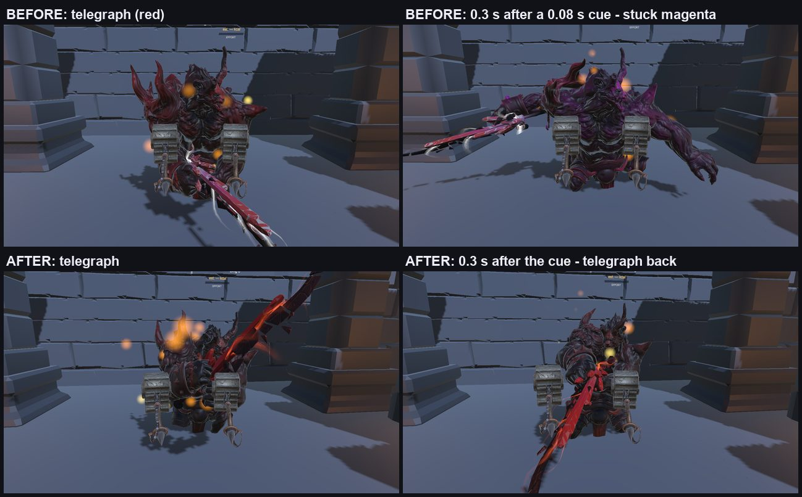
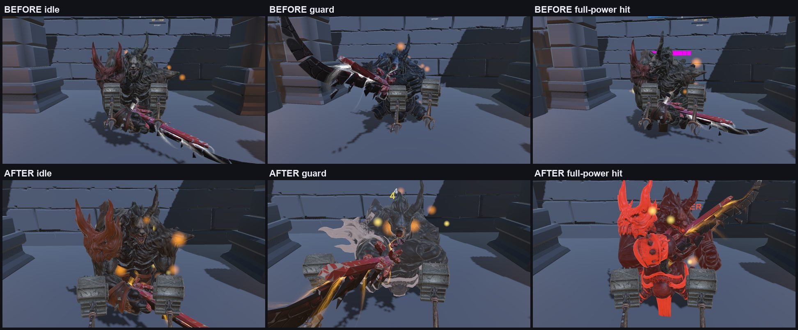
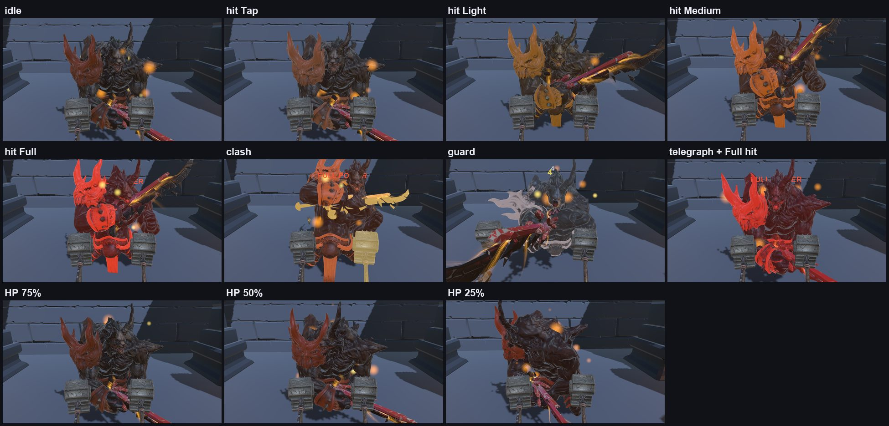
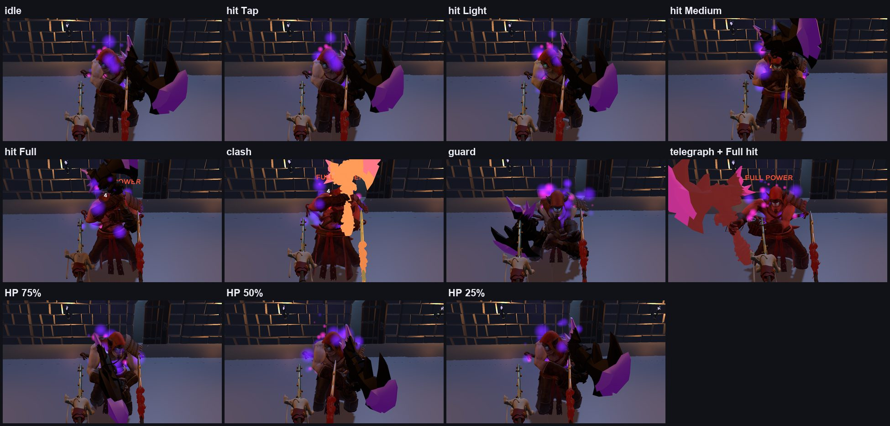
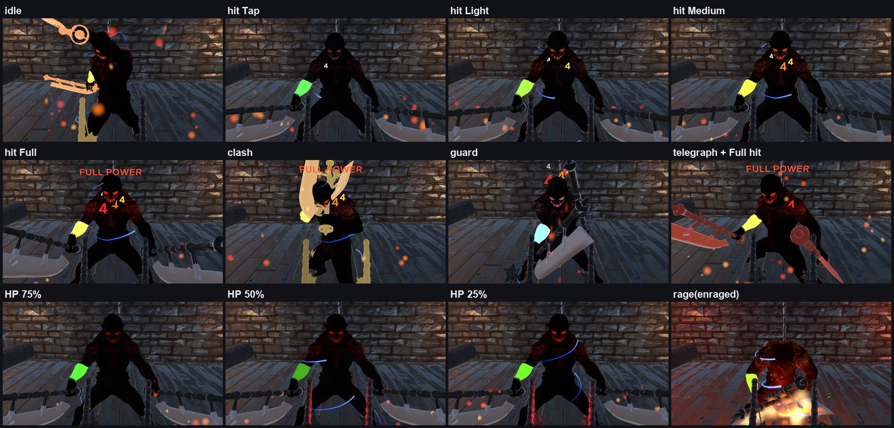

# Monster and weapon colour: audit and compositor

**Date:** 23 October 2026. Everything below was read from the code and the prefabs, or measured in Play mode in the Unity Editor
(Mac, Game-view renders from the player's head position). Nothing here was measured on a Quest; how the colours look in the
headset still has to be checked there.

---

## 1. Audit (before the change)

### Who wrote colour, and where

| Script | Renderer(s) | Property | When | Block |
|---|---|---|---|---|
| `MonsterAI.SetBodyTint` / `TintRenderer` | `telegraphRenderer` (the body) and `extraTintRenderers` (Level 3 axes) | `_BaseColor`, `_Color` | guard raise flash, guard tint, stagger flash, block flash, `FlashTint` (MonsterDefense opening cue), `ClearBodyTint` (back to `restingTint`) | renderer-wide (Levels 1-2), per slot (Level 3) |
| `MonsterAI.TelegraphFlash` | the body | `_BaseColor`, `_Color` | every attack wind-up: **saves** the current colour, sets the telegraph colour, **restores** the saved colour when the wind-up ends | renderer-wide (Levels 1-2) |
| `BossPhaseController` (through `MonsterAI.restingTint` + `ApplyRestingTint`) | the body | `_BaseColor` | Level 3 enrage ramp | as above |
| `MonsterGlow` | Level 3 body slots 0-1 | `_EmissionColor` | every frame (breathing glow, telegraph surge, phase flare, death collapse) | per slot |
| `MonsterWeakPoint` | Level 3 body slot 2 | `_EmissionColor` | every frame (pulse, hit flash) | per slot |
| `MonsterFireAura.SetPulse` | Levels 1-2 body | `_EmissionColor` (material emission + pulse) | 20 Hz while the aura burns | renderer-wide |
| `MonsterEntrance.Drop.SetEmission` | Level 2 body | `_EmissionColor` | the drop entrance (dark, eyes open, glow, back to the material) | renderer-wide |
| `MonsterAnimator.Flash` | `fallbackRenderer` | `_BaseColor`, `_Color` | hits, only when there is no Animator (not used by the three prefabs) | renderer-wide |
| Player weapons | | | nothing wrote their colour | |

### Where two writers collide

1. **Telegraph against any other `_BaseColor` writer (Levels 1-2).** `TelegraphFlash` saves the colour at the start of the wind-up
   and writes it back at the end. A guard tint, block flash, stagger flash or opening cue written during the wind-up is erased
   when it ends, and a stale colour saved at the start is restored after the effect that caused it is long gone.
2. **`FlashTint` (MonsterDefense opening cue) during a wind-up.** `FlashTintRoutine` only restores the colour when the monster is
   not attacking, so during a wind-up its 0.08 s flash **replaces the telegraph for the rest of the wind-up**. Verified below.
3. **"Clear" is not "the material".** `ClearBodyTint` writes `restingTint` (white) into `_BaseColor`, which replaces the material's own
   colour (Level 1 body 0.8 grey, Level 3 axe blade 0.78) with 1.0 after the first tint of a fight. The look changes once, for no
   reason.
4. **Level 2 body emission:** `MonsterFireAura` and `MonsterEntrance.Drop` both write the body's `_EmissionColor` on the same
   renderer-wide block during the entrance.
5. **Hits never showed on the body** (except the Level 3 weak point and the stagger), and nothing showed on the player's weapons.
6. **Emission written through a property block never showed on Level 1, on the monster weapons or on the player weapons:** their
   materials had no `_EMISSION` keyword, so `MonsterFireAura`'s pulse on Level 1 was invisible all along.

### Runtime evidence of collision 2 (Level 1, Play mode)

A forced table attack (`DebugForceAttack(0)`, "Slash", wind-up 0.9 s); once the red telegraph showed, `ai.FlashTint(magenta, 0.08 s)`,
the call MonsterDefense makes for an opening cue. Body block, every frame (excerpt):

```
0.000 base=RGBA(1.00, 0.20, 0.20)   telegraph on
0.072 base=RGBA(1.00, 0.20, 0.20)
      FlashTint(magenta, 0.08) called
0.116 base=RGBA(1.00, 0.00, 1.00)   the cue
0.472 base=RGBA(1.00, 0.00, 1.00)   still magenta 0.36 s later: the telegraph is gone
1.001 base=RGBA(1.00, 1.00, 1.00)   wind-up over, TelegraphFlash restores its saved white
```



The same probe after the change (the cue lasts one frame, the telegraph keeps pulsing until the wind-up ends):

```
0.275 base=(0.80, 0.33, 0.29) emis=(1.07, 0.34, 0.08) tele=0.72 cue=0.00
      FlashTint(magenta, 0.08) called
0.298 base=(0.80, 0.18, 0.22) emis=(1.34, 0.35, 0.27) tele=0.89 cue=0.50
0.398 base=(0.80, 0.35, 0.31) emis=(1.02, 0.33, 0.08) tele=0.67 cue=0.00
0.669 base=(0.80, 0.18, 0.16) emis=(1.17, 0.33, 0.09) tele=1.00
1.300 base=(0.80, 0.71, 0.58) emis=(1.03, 0.58, 0.18) tele=0.00   back to the Level 1 palette
```

---

## 2. The compositor

One writer per object: **`MonsterColorCompositor`** on each monster root and **`PlayerWeaponGlow`** on each player weapon (same base
class, `ColorCompositor`). They are the only code that calls `SetPropertyBlock` on those renderers. Every other script describes what
happened through the layer API (`SetLayer(layerId, color, intensity, duration, curve)` / `ClearLayer`, or named helpers such as
`Telegraph`, `Cue`, `NotifyDamage`, `Strike`, `NotifyParry`, `SetRage`). The old direct writes only run for a monster that has no
compositor, so they can no longer touch these blocks.

**Layers, in blend order** (`StrikeFit.ColorFx.ColorLayer`):

| Layer | Source | Groups |
|---|---|---|
| palette (resting tint and accent) | `MonsterColorPalette` per level | each group's own |
| aura / entrance / glow / weak point | `MonsterFireAura`, `MonsterEntrance.Drop`, `MonsterGlow`, `MonsterWeakPoint` | body / glow / weak point |
| wound | the monster's HP, every frame (stronger as HP drops) | body |
| rage | Level 3 enrage blend | body |
| guard | held while `MonsterAI.IsDefending` | body |
| cue | guard raise, block, stagger, opening | body |
| hit | `MonsterController.OnTakeDamage`, colour from the swing tier (Tap, Light, Medium, Full; weak point; blocked; resisted), 0.15-0.25 s decay | body |
| strike | the monster's attack landed (weapon); the player was hit (player weapons) | weapons |
| clash rim + clash / parry | `HitDetection.WeaponClashed`; parry from `MonsterAI` | body rim + the monster's weapon + the player weapon that clashed |
| telegraph | `MonsterAI.TelegraphFlash`, pulsing | everything |
| death | `MonsterController.OnMonsterDeath`, after a delay so the death flash plays | everything |

**Blend rules** (`ColorStack.Evaluate`): base colours lerp by weight, lowest layer first, and multiply each material's own colour
(white = the material as authored, which also fixes collision 3). Emission layers add and are clamped (largest channel at most
`maxEmission`, hue kept), so stacked effects never blow out to white. While a telegraph shows, the other emission is clamped to
`maxEmission - telegraphReserve`, the telegraph adds at least `telegraphMinEmission`, and the base colour reaches at least
`telegraphMinWeight` toward its colour, so it is always readable. Death fades last. The result depends only on the layer states and
the time, never on call order.

**Cost:** each group is evaluated once per frame and its slots are written only when the result changed (none while nothing moves).
Renderers, material colours and shader IDs (`ShaderIds`) are cached, and the update path allocates nothing (EditMode tests).

**Materials:** emission set through a property block only shows with the `_EMISSION` keyword. `Editor/ColorCompositorSetup` enables it
with an invisible emission colour (0.002) on the monster and player weapon materials. They also get the realtime-emissive GI flag,
because URP's Lit validation drops the keyword when the flags are None (tested). Realtime GI is off in every scene, so that flag
changes no lighting. Smoothness and metallic are untouched (the less-shiny metal fix stays). The Level 1 sword's embedded
`lambert2` is replaced by `M_L1_MonsterSwordMetal`, an identical copy with emission on. One sword piece uses URP's own read-only
`Lit.mat` and the glow planes are Unlit, so those take only the base colour.

**Level 1 accent:** `Warrok_AccentMask.png` (built from the body texture: red and brown leather armour and trims = 1, fur and skin =
0.3) is the body's emission map, so the palette's amber accent sits on the armour and a hit flash still reads on the skin.

---

## 3. Palettes (`Assets/Settings/Color/`)

| Level | Look |
|---|---|
| L1 Gatekeeper | warmer body tint, amber glow on the leather armour (mask), gold-amber sword glow planes, fire smoulder kept low (it never showed before), emission cap 0.9 |
| L2 Crimson Warden | crimson cloth with a violet smoulder, violet axe edge (matches its violet fire aura); its authored emission map (eyes, runes) limits emission flashes, so its hits lean on a stronger base shift (weight 0.75); cap 1.1 |
| L3 Harbor Tyrant | MonsterGlow keeps its glow mask; a faint ember on the axe blades, an orange rage rim; flashes need about twice the emission (near-black body, crack mask); cap 2.0 |
| Player weapons | one shared `PlayerWeaponGlow_Profile`: the same tier colours as the damage numbers, a gold clash, a blue parry, a red "you were hit" flash |

`Editor/ColorCompositorSetup` (menu **StrikeFit > Colour > Wire Compositors**) rebuilds the wiring; **Force Palettes** also resets the
palettes to these values. An Editor-only **Colour Layer Preview** component fires every layer from the Inspector in Play mode.

---

## 4. Play-mode results (Editor renders)

Level 1, before and after (the before frames were taken from slightly further back):



Every layer, per level (idle, the four hit tiers 0.04 s after the hit, clash, guard, telegraph with a full-power hit landing during
it, HP 75 / 50 / 25 %, Level 3 enraged). The hits went through `MonsterController.OnTakeDamage` at speeds in each tier's band. The
clash went through `HitDetection`'s own clash path, with only the "needs a swing" gate lifted for that one call because the test
weapon was at rest. Wounds were set by HP, and the rage was the boss's own enrage after a real hit at 31 % HP.





What the frames show, and what they do not:

- The telegraph stays red over a simultaneous full-power hit flash on every level.
- On Level 1 the tiers read clearly (pale, yellow, orange, red), and the clash flashes the monster's sword and the player's hammer
  together.
- On Level 2 the Tap / Light / Medium flashes are subtle. Its dark texture and its authored emission mask limit both channels.
- On Level 3 the flashes show in the glow cracks and the weak point, not across the whole body.
- The Level 3 "idle" frame caught a real attack in progress.
- Console: no errors in any run. The only warnings were from the test setup: the redirected telemetry failing to reach
  `127.0.0.1:9`, and one camera setting in an early capture script.

**Only the headset can confirm** the final look: brightness on the Quest display without HDR, and whether the emission cap is right
there.
