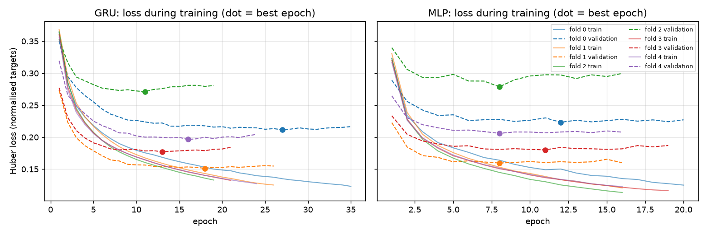
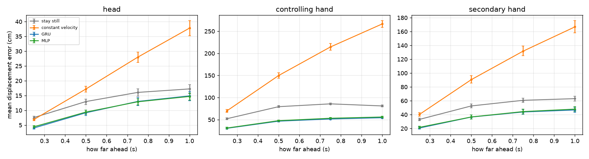
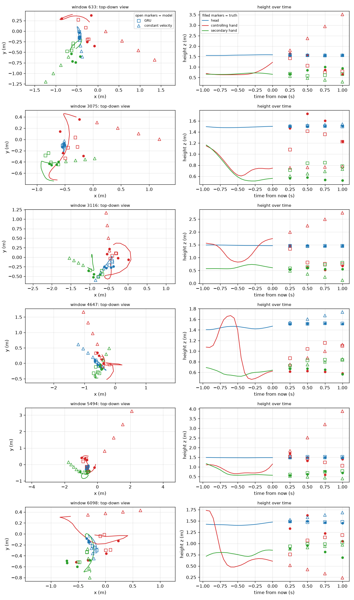

# STRIKEFIT motion forecaster: what we built and how well it works

This page explains the machine-learning part of STRIKEFIT in one place: the problem, the data, the neural network, how it was
trained and tested, the results, and how the game uses it. Every number here comes from the files in [`reports/`](reports/) and
[`models/`](models/), produced by `uv run python -m strikefit_ml.pipeline`.

## 1. The problem

In Level 3 ("Expert" mode) the monster should react to where the player is **about to be**, not only where they are now.
The model looks at the **last 1.0 s** of the player's head and both hands and predicts where those three points will be
**0.25, 0.50, 0.75 and 1.00 s** later.

- Input: 20 frames (1.0 s at 20 Hz) of head, controlling-hand and secondary-hand positions.
- Output: 36 numbers = 4 horizons × 3 tracked points × (x, y, z), each an offset in metres from the point's current position.
- The prediction is a hint to the monster's AI. It is never trusted blindly: the game's fairness rules always decide.
- The game reads only the **head** prediction, up to 0.75 s ahead (section 7 explains why).

## 2. The data

| | |
|---|---|
| Dataset | Touché: Data-Driven Interactive Sword Fighting in Virtual Reality (Dehesa, Vidler, Lutteroth, Padget, CHI 2020), gesture-detection sword-strike set |
| Licence | CC BY 4.0 |
| Size | 8 recordings, 12.1 minutes, 7,103 training windows (one every 2 frames) |
| Recorded | 2017, room-scale VR headset and two controllers, a person doing sword strikes in a lab |

The data was cleaned before use ([notebooks 01 and 02](notebooks/)):

- **Units.** The audit showed the raw positions are in centimetres, so they were converted to metres.
- **Time.** Recordings were cut wherever there was a time jump larger than 0.1 s, then resampled to exactly 20 Hz.
- **Axes.** The dataset uses z-up. The game converts Unity's y-up axes to match (see section 7).

## 3. Features (what the network sees)

Each of the 20 frames has 22 features ([`feature_engineering.py`](src/strikefit_ml/feature_engineering.py), notebook 03):

| # | features | why |
|---|---|---|
| 1–9 | head, controlling hand and secondary hand positions **relative to the head in the last frame** | makes the model independent of where the player stands in the room |
| 10–18 | velocity of each point (difference between neighbouring frames × 20 Hz) | tells the model which way and how fast things move |
| 19–20 | speed of each hand | a strike is easiest to spot as a burst of hand speed |
| 21 | absolute head height | separates crouching or ducking from standing |
| 22 | grip | always 1 in this dataset (kept so the inputs match the game's controllers) |

All features and targets are normalised with `(x − mean) / std`, computed **only from the training recordings** of each fold,
so no information leaks from the test data.

## 4. The neural network

We compared two small neural networks. Both had to stay under 200,000 parameters so they run on a Meta Quest 2 next to the game.

### GRU (final model)

A **GRU (Gated Recurrent Unit)** is a recurrent neural network: it reads the 20 frames one after another and keeps a memory
(its hidden state) of the movement so far. That suits motion, where the order of the frames matters.

```
input (1 × 20 × 22)
   → GRU, 1 layer, hidden size 64      reads the frames in order
   → final hidden state (64)
   → Linear 64 → 36                     the 36 predicted offsets
```

- **19,236 parameters** in total.
- For the export, the GRU is rewritten as plain matrix products, `sigmoid` and `tanh` (`GRUUnrolled` in
  [`models.py`](src/strikefit_ml/models.py)) with the same weights. The ONNX file then needs no special GRU operator, which
  Unity's inference engine might not support.

### MLP (comparison model)

A **multi-layer perceptron** flattens the whole window into one list of 440 numbers and passes it through two hidden layers:
`440 → 128 → 128 → 36` with ReLU (77,604 parameters). It ignores frame order, so it shows whether a recurrent model actually helps.

### Two baselines with no learning

A model is only useful if it beats simple rules, so two baselines were scored on exactly the same test windows:

- **Stay still:** assume nobody moves (predict an offset of zero).
- **Constant velocity:** keep moving at the average speed of the last 3 frames.

## 5. Training

| setting | value |
|---|---|
| Loss | Huber loss (δ = 1.0) on normalised targets: less thrown off by a few very large errors than squared error |
| Optimiser | AdamW, learning rate 0.002, weight decay 0.0001 |
| Batch size | 256 |
| Epochs | up to 60, **early stopping** after 8 epochs without improvement on the validation recordings |
| Seed | 42 |
| Hardware | Apple GPU (MPS); one fold trains in 2–5 seconds |

Every fold stopped early. Best epochs for the GRU were 27, 18, 11, 13 and 16, with a median of **16**
([`training_summary.csv`](reports/training_summary.csv)). The final model was then retrained on all 8 recordings for 16 epochs.



## 6. How it was tested, and the results

### Method

With only 8 recordings and no participant IDs, a single train/test split would be unreliable. We used **5-fold
cross-validation by recording**:

- Each recording is test data exactly once, for a model that never saw it (test recordings per fold: 2, 2, 2, 1, 1).
- One more training recording per fold is held back to decide when to stop training.
- Splitting by **recording**, not by window, matters: neighbouring windows from one recording are almost identical, so a
  window-level split would leak test data into training and flatter the model.

**Metric:** mean displacement error in **centimetres**, the straight-line distance between the predicted and the real
position, averaged over all test windows (lower is better).
**Confidence intervals:** 95% bootstrap intervals with 1,000 resamples of **whole recordings**.

### Overall result

| model | overall error (cm) [95% interval] | 0.25 s | 0.50 s | 0.75 s | 1.00 s |
|---|---|---|---|---|---|
| stay still (baseline) | 46.79 [45.46, 48.07] | 30.92 | 48.29 | 54.16 | 53.78 |
| constant velocity (baseline) | 101.64 [97.72, 105.45] | 39.03 | 85.85 | 124.69 | 157.02 |
| MLP | 31.67 [29.94, 33.33] | 19.04 | 31.26 | 36.82 | 39.55 |
| **GRU (final)** | **30.98 [29.24, 32.71]** | **18.37** | **30.76** | **36.12** | **38.67** |



What this shows:

- **The GRU beats the best baseline clearly:** 31.0 cm against 46.8 cm for "stay still", **34% lower error**, and the 95%
  intervals do not overlap. Per horizon the gain is 41% at 0.25 s, 36% at 0.5 s, 33% at 0.75 s and 28% at 1.0 s.
- **Constant velocity is the worst model.** Sword strikes speed up and stop sharply, so extending the current speed overshoots
  badly, and the error grows with the horizon (39 cm → 157 cm).
- **GRU and MLP are almost equal.** The GRU is 0.7 cm better overall and slightly better at every horizon, but their
  intervals overlap, so the data does not prove the GRU is better. It was chosen because it is better on every horizon and
  **four times smaller** (19 k against 78 k parameters), which matters on a Quest 2.
- **Error grows with how far ahead we look:** 18 cm at 0.25 s, 39 cm at 1.0 s. Near-term predictions are the most useful ones.

### Result per tracked point (GRU, all horizons)

| point | GRU (cm) | stay still (cm) | constant velocity (cm) |
|---|---|---|---|
| head | 10.3 | 13.5 | 22.5 |
| controlling (sword) hand | 45.7 | 74.5 | 175.1 |
| secondary hand | 36.9 | 52.4 | 107.3 |

The head is easy to predict because it moves little. The sword hand is the hardest because it is what swings, but it is
also where the model gains the most over "stay still" (74.5 → 45.7 cm).



## 7. Export and use in the game

| file | what it is |
|---|---|
| [`models/motion_forecaster.onnx`](models/motion_forecaster.onnx) | the model for Unity (ONNX opset 15, fixed shapes: input `window` [1, 20, 22], output `offsets` [1, 36]) |
| [`models/motion_forecaster.pt`](models/motion_forecaster.pt) | the PyTorch weights |
| [`models/norm.json`](models/norm.json) | the means and standard deviations for scaling the input and output |
| [`models/golden_vector.json`](models/golden_vector.json) | one real input with its expected output, to check the Unity side |
| [`models/model_card.md`](models/model_card.md) | the generated model card: input/output order and limits |

- **PyTorch vs ONNX parity:** on the golden vector the largest difference between the two outputs is **1.0 × 10⁻⁶**,
  well inside the allowed 1 × 10⁻⁴.
- **In Unity:** `Assets/Scripts/Monster/ExpertAI/` runs the model with Unity's Inference Engine on the CPU.
  `ForecastMath.cs` rebuilds the same 22 features and the axis mapping. `ExpertMotionPredictor.cs` samples the head and
  controllers at 20 Hz and runs an inference 10 times a second, spread over several frames. If anything goes wrong (missing model,
  NaN output, inference too slow), Expert mode switches itself off and Level 3 plays as normal.
  `Assets/Tests/EditMode/ExpertAI/ExpertAITests.cs` checks the Unity output against the golden vector within 1 × 10⁻⁴; it passed
  in the batch-mode run of 23 October 2026 (68 of 68 EditMode tests).
- **What the game reads:** only the **head** prediction, up to **0.75 s** (config `maxHorizonSeconds`). In the game, measured with
  scripted player motion on the same moments (`Captures/ExpertAI/L3_expert_60s.txt`):

  | horizon | head: model / stays still (cm) | dominant hand: model / stays still (cm) |
  |---|---|---|
  | 0.25 s | 8.0 / 14.1 | 43.0 / 17.3 |
  | 0.50 s | 19.3 / 25.7 | 73.0 / 31.4 |
  | 0.75 s | 32.3 / 35.6 | 83.2 / 43.4 |
  | 1.00 s | 44.0 / 43.8 | 81.7 / 52.9 |

  The head prediction helps up to 0.75 s; the hand prediction is worse than "stays still" at every horizon in the game, although it
  beat it on the dataset (section 6). The hands are therefore behind the flag `useHandPrediction`, off by default.
- **Keeping the copies in sync:** `scripts/sync_model_to_unity.sh` copies the three files into `Assets/Models/ExpertAI/` and checks
  their SHA-256 (`--check` only compares). On 23 October 2026 all three were identical.

## 8. Limits (read before relying on the numbers)

- **Very little data:** 8 recordings and about 12 minutes, probably from very few people. The model has not seen different
  bodies or movement styles.
- **Different task:** the recordings are lab sword strikes. In STRIKEFIT the player dodges and attacks a monster.
- **Positions only:** no rotations. All players in the data face about the same way, so a player facing another way is unfamiliar.
- **Different hardware:** recorded in 2017 with a room-scale headset. Quest 2 tracking differs in noise, delay and update rate.
- **The final model has no test set of its own.** It was retrained on all 8 recordings, so the results above describe the
  cross-validation models, which share its architecture and settings.
- **~31 cm average error over 1 s** is a useful hint for the monster's AI, not an exact prediction.
- **Hands do not transfer to the game.** The hand predictions beat "stays still" on the dataset but not in the game's scripted test,
  so the game reads the head only.
- **Not yet run on a Quest.** Inference time (1.4 ms on average in the Editor) and the axis mapping still need checking on the headset.

## 9. Reproduce it

```bash
cd ml-services
uv sync                                   # install the dependencies (Python ≥ 3.12)
uv run python -m strikefit_ml.pipeline    # all nine steps, about 30 seconds
uv run pytest                             # 12 tests that need no dataset
scripts/sync_model_to_unity.sh --check    # are the Unity copies identical to models/?
uv run jupyter lab                        # notebooks 01–06, one per step, with plots
```

The raw data is not committed. Put the Touché gesture-detection data in `data/raw/touche_sword_strikes/`
(exact path in [`configs/motion_forecaster.yaml`](configs/motion_forecaster.yaml), which holds every setting used above).
